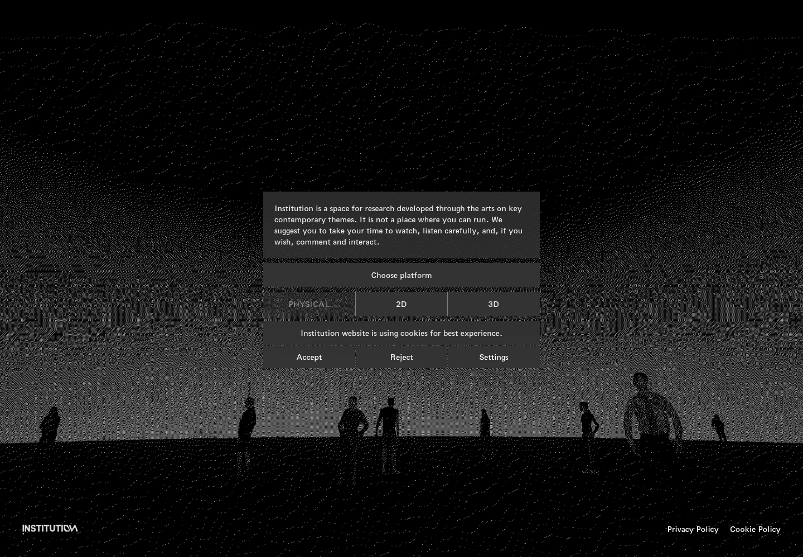
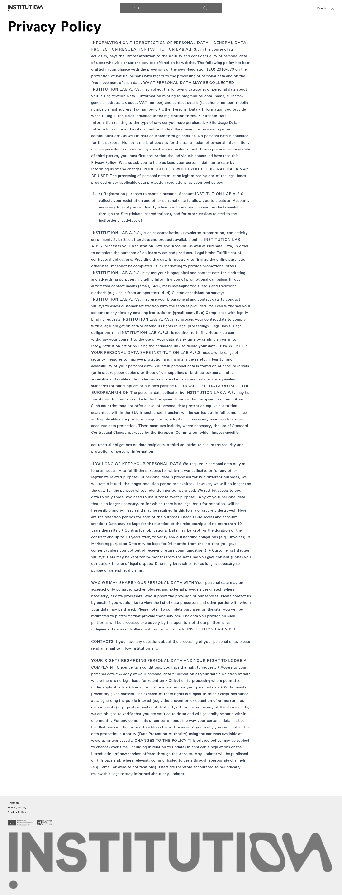
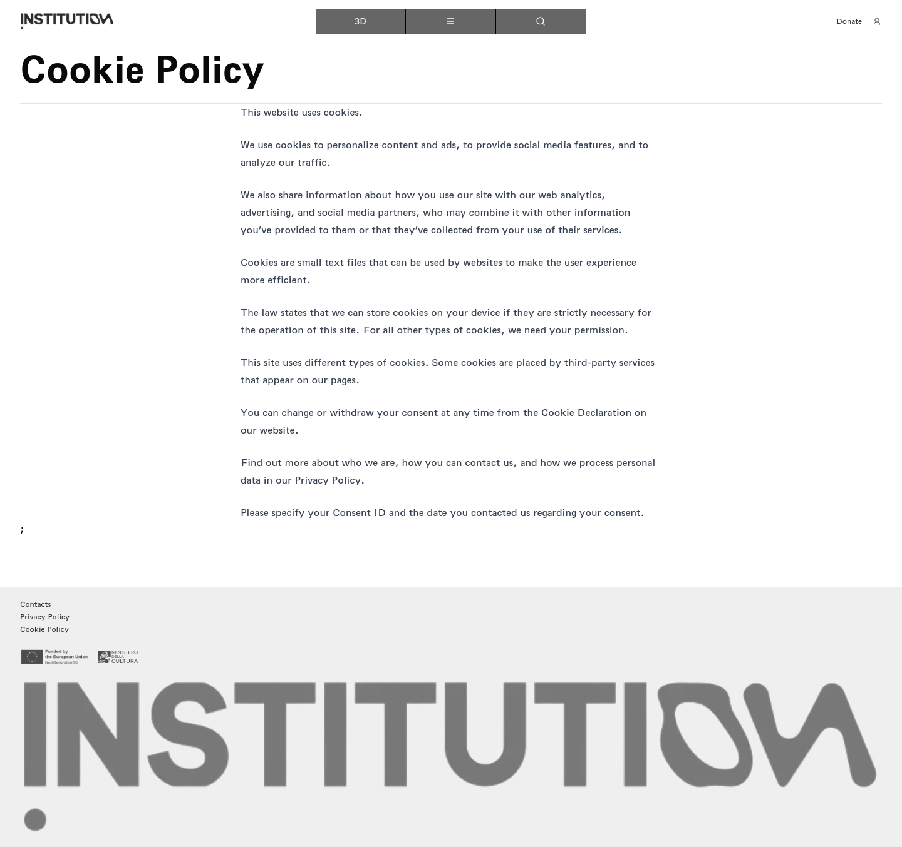

# 01｜首页与 Cookie

[返回总目录](../README.md) · [下一章：地图入口、菜单与语言](02-map.md)

**路线：** 从首页出发；接受、拒绝、设置为不同分支，不能在同一次状态中连续执行。

> Figma 尚未取得，以下全部是网站实测。未编造设计画面；比较列保留“待匹配”。

## W001｜首次打开首页

- **用户操作：** 从给定网址进入。
- **操作后结果：** 中央为机构介绍、平台选择及 Cookie 提示，底部有标识与政策入口。
- **中文备注／不确定性：** 黑白点云背景为动态画面；截图只记录捕获瞬间。PHYSICAL 带 disabled 属性，不能进入。
- **Figma：** 尚未取得设计画板，无法匹配。
- **来源：** 2026-10-16 网站实测，旧版证据编号 001。

[查看／下载原始截图](../screenshots/01-home.png)

## W002｜接受 Cookie 后的首页

- **用户操作：** 在另一条首页分支点击 Accept（接受）。
- **操作后结果：** Cookie 提示消失。
- **中文备注／不确定性：** 与拒绝后的可见布局相近；不能凭外观相近认定接受按钮无效。
- **Figma：** 尚未取得设计画板，无法匹配。
- **来源：** 2026-10-16 网站实测，旧版证据编号 002。

[查看／下载原始截图](../screenshots/13-cookie-accepted.png)

## W003｜拒绝 Cookie 后的首页

- **用户操作：** 点击 Reject（拒绝）。
- **操作后结果：** Cookie 提示消失，平台选择与政策入口保留。
- **中文备注／不确定性：** 拒绝操作仅改变当前浏览器的同意状态，不会直接进入平台。
- **Figma：** 尚未取得设计画板，无法匹配。
- **来源：** 2026-10-16 网站实测，旧版证据编号 003。

[查看／下载原始截图](../screenshots/03-home-clean.png)

## W004｜Cookie 设置最终复核

- **用户操作：** 页面加载完成后点击 Settings，等待 5 秒。
- **操作后结果：** 页面正文与点击前相同，没有新面板。
- **中文备注／不确定性：** 记录 sameText 证据；这是当前测试条件的可见结果，未推断后台是否记录事件。
- **Figma：** 尚未取得设计画板，无法匹配。
- **来源：** 2026-10-16 网站实测，旧版证据编号 004。

[查看／下载原始截图](../screenshots/settings-confirmed.png)

## W005｜复测 Cookie 设置

- **用户操作：** 重新进入首页后点击 Settings。
- **操作后结果：** 没有出现设置面板或新页面。
- **中文备注／不确定性：** 与首次及后续 5 秒等待复测一致；列入无可见响应汇总。
- **Figma：** 尚未取得设计画板，无法匹配。
- **来源：** 2026-10-16 网站实测，旧版证据编号 005。

[查看／下载原始截图](../screenshots/cookie-settings-retest.png)

## W006｜阅读隐私政策

- **用户操作：** 点击首页或页脚 Privacy Policy。
- **操作后结果：** 打开完整隐私政策正文。
- **中文备注／不确定性：** 长页面截图包含数据处理、保存、共享及权利条款；可放大原图阅读。
- **Figma：** 尚未取得设计画板，无法匹配。
- **来源：** 2026-10-16 网站实测，旧版证据编号 006。

[查看／下载原始截图](../screenshots/14-privacy.png)

## W007｜阅读 Cookie 政策

- **用户操作：** 点击 Cookie Policy。
- **操作后结果：** 显示 Cookie 用途、第三方及同意说明。
- **中文备注／不确定性：** 政策文字提到可更改同意，但本次首页 Settings 没有展开设置。
- **Figma：** 尚未取得设计画板，无法匹配。
- **来源：** 2026-10-16 网站实测，旧版证据编号 007。

[查看／下载原始截图](../screenshots/15-cookie-policy.png)

---

[返回总目录](../README.md) · [下一章：地图入口、菜单与语言](02-map.md)
