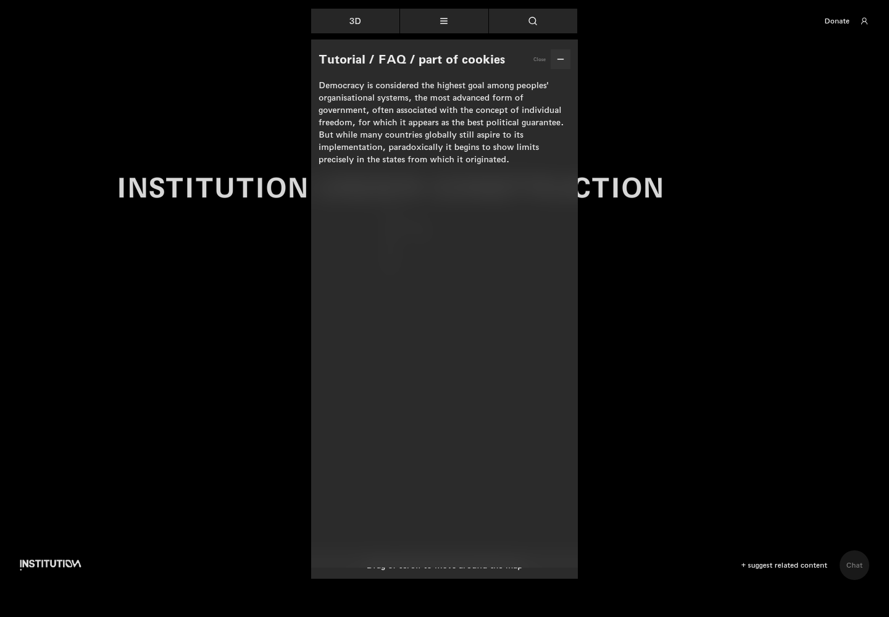
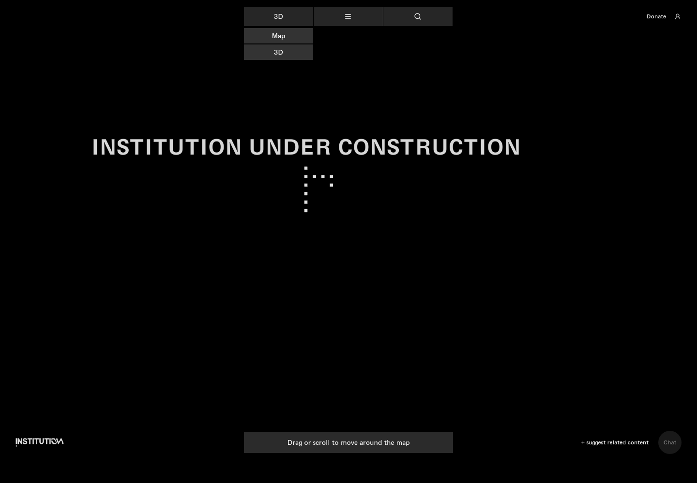
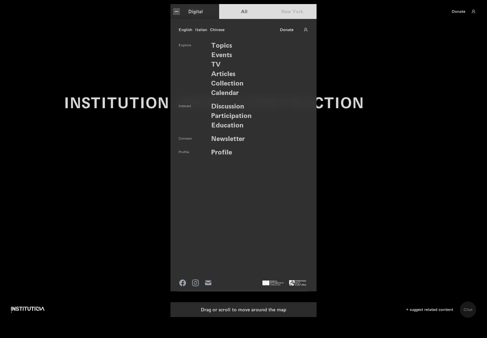
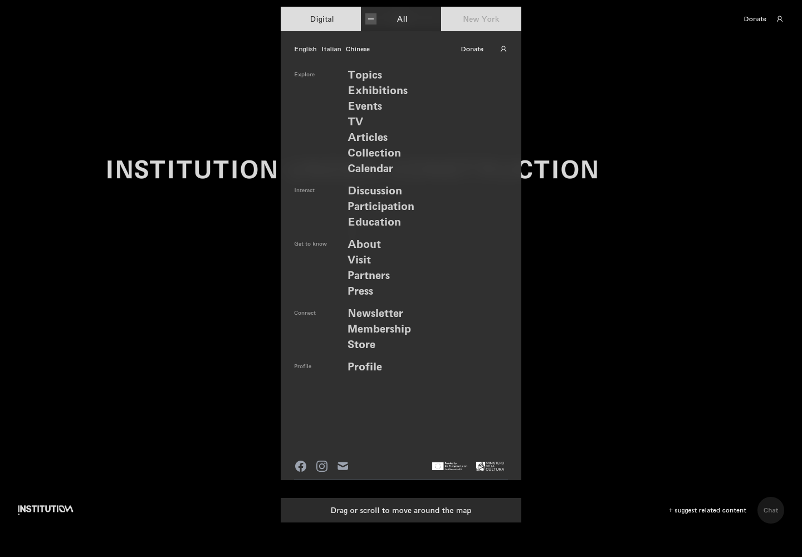
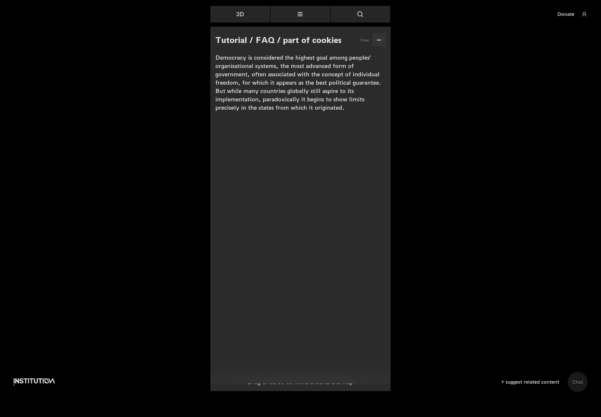

# 02｜地图入口、菜单与语言

[返回总目录](../README.md) · [上一章：首页与 Cookie](01-home.md) · [下一章：搜索与地图移动](03-search.md)

**路线：** 从首页选择 2D；关闭介绍后再展开平台、导航和语言入口。

> Figma 尚未取得，以下全部是网站实测。未编造设计画面；比较列保留“待匹配”。

## W008｜进入 2D：首次说明面板

- **用户操作：** 首页选择 2D，打开 /en/map。
- **操作后结果：** 中央出现 Tutorial / FAQ / part of cookies 说明面板，顶部仍显示 3D。
- **中文备注／不确定性：** 说明正文讨论民主，并非完整的操作教程；这是当时页面实际内容。
- **Figma：** 尚未取得设计画板，无法匹配。
- **来源：** 2026-10-16 网站实测，旧版证据编号 008。

[查看／下载原始截图](../screenshots/06-map-intro.png)

## W009｜关闭地图介绍

- **用户操作：** 点击说明面板右上角 Close（关闭）。
- **操作后结果：** 说明面板收起，露出地图背景与顶栏。
- **中文备注／不确定性：** 地图主视图当时主要显示黑色背景和机构字样；不把空背景当作已展示全部地图节点。
- **Figma：** 尚未取得设计画板，无法匹配。
- **来源：** 2026-10-16 网站实测，旧版证据编号 009。

[查看／下载原始截图](../screenshots/07-map-intro-closed.png)

## W010｜展开平台切换

- **用户操作：** 点击顶部显示 3D 的下拉框。
- **操作后结果：** 出现 Map（地图）与 3D 两个选项。
- **中文备注／不确定性：** 页面路径是 /en/map，顶栏却显示 3D；记录为标签与当前路径不一致。
- **Figma：** 尚未取得设计画板，无法匹配。
- **来源：** 2026-10-16 网站实测，旧版证据编号 010。

[查看／下载原始截图](../screenshots/08-mode-selector.png)

## W011｜展开主菜单：数字平台

- **用户操作：** 点击顶栏三横线菜单。
- **操作后结果：** 显示 Digital、All、New York、语言切换、栏目及社交入口。
- **中文备注／不确定性：** 菜单覆盖原顶栏；应先关闭菜单再操作原顶栏，避免误判被遮挡按钮无反应。
- **Figma：** 尚未取得设计画板，无法匹配。
- **来源：** 2026-10-16 网站实测，旧版证据编号 011。

[查看／下载原始截图](../screenshots/09-main-menu.png)

## W012｜切换完整导航

- **用户操作：** 在菜单点击 All（全部）。
- **操作后结果：** 新增展览、关于、参观、合作伙伴、媒体、会员和商店入口。
- **中文备注／不确定性：** New York 灰显且不是可用标签；Digital 与 All 是实际标签控件。
- **Figma：** 尚未取得设计画板，无法匹配。
- **来源：** 2026-10-16 网站实测，旧版证据编号 012。

[查看／下载原始截图](../screenshots/22-menu-all.png)

## W013｜切换中文地图

- **用户操作：** 通过 Chinese（中文）入口打开 /zh/map。
- **操作后结果：** 出现“捐赠支持”“即时聊天”等中文标签。
- **中文备注／不确定性：** 教程正文仍为英文；存在混合语言显示。
- **Figma：** 尚未取得设计画板，无法匹配。
- **来源：** 2026-10-16 网站实测，旧版证据编号 013。

[查看／下载原始截图](../screenshots/map-chinese.png)

## W014｜切换意大利语地图

- **用户操作：** 通过 Italian 入口打开 /it/map。
- **操作后结果：** 进入意大利语路径，地图结构保留。
- **中文备注／不确定性：** 当时多数可见提示仍为英文；不把路径切换等同于全部内容翻译完成。
- **Figma：** 尚未取得设计画板，无法匹配。
- **来源：** 2026-10-16 网站实测，旧版证据编号 014。

[查看／下载原始截图](../screenshots/map-italian.png)

---

[返回总目录](../README.md) · [上一章：首页与 Cookie](01-home.md) · [下一章：搜索与地图移动](03-search.md)
