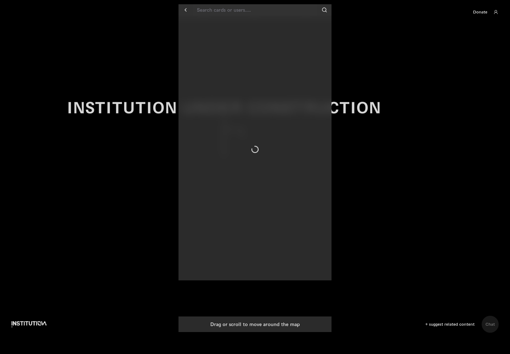
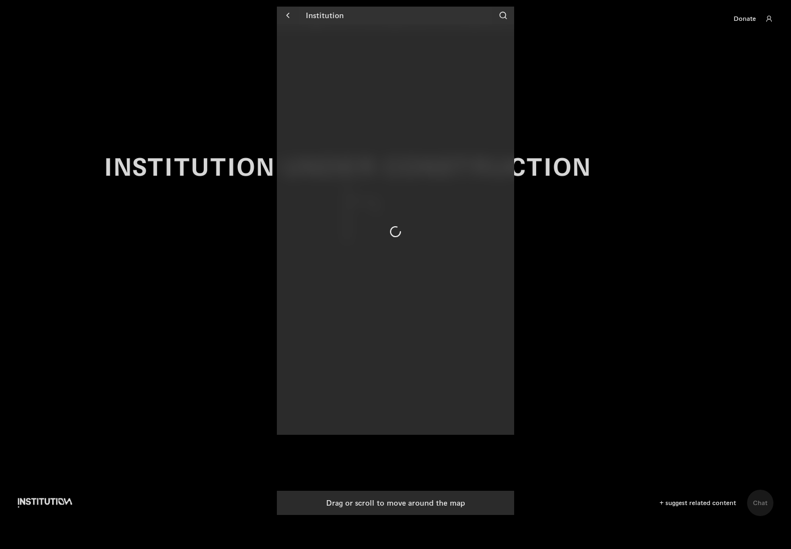
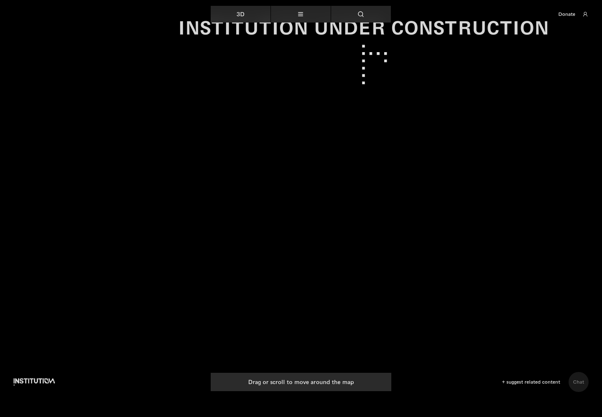

# 03｜搜索与地图移动

[返回总目录](../README.md) · [上一章：地图入口、菜单与语言](02-map.md) · [下一章：主题与数字路径](04-topics.md)

**路线：** 关闭其他面板后从地图顶栏进入搜索；不同关键词是独立检索分支。

> Figma 尚未取得，以下全部是网站实测。未编造设计画面；比较列保留“待匹配”。

## W015｜打开搜索框

- **用户操作：** 关闭介绍后点击顶栏放大镜。
- **操作后结果：** 显示返回箭头、输入框和搜索按钮。
- **中文备注／不确定性：** 输入框提示为“搜索卡片或用户”；尚未填写时没有结果列表。
- **Figma：** 尚未取得设计画板，无法匹配。
- **来源：** 2026-10-16 网站实测，旧版证据编号 015。

[查看／下载原始截图](../screenshots/17-search-open.png)

## W016｜搜索无结果分支

- **用户操作：** 输入 democracy 并等待搜索响应。
- **操作后结果：** 出现 0 results 与 No results found（没有结果）。
- **中文备注／不确定性：** 空搜索结果属于功能反馈，不能列作点击无反应。
- **Figma：** 尚未取得设计画板，无法匹配。
- **来源：** 2026-10-16 网站实测，旧版证据编号 016。

[查看／下载原始截图](../screenshots/18-search-typed.png)

## W017｜输入有效关键词

- **用户操作：** 在搜索框填写 Institution。
- **操作后结果：** 截图记录输入后的即时状态。
- **中文备注／不确定性：** 最终结果以点击搜索后的下一镜为准，避免把等待状态当成失败。
- **Figma：** 尚未取得设计画板，无法匹配。
- **来源：** 2026-10-16 网站实测，旧版证据编号 017。

[查看／下载原始截图](../screenshots/search-institution.png)

## W018｜查看搜索结果

- **用户操作：** 点击搜索框右侧放大镜。
- **操作后结果：** 显示 2 条结果：机构文章与机构实验室视频。
- **中文备注／不确定性：** 结果标题对应已记录的文章详情与视频详情。
- **Figma：** 尚未取得设计画板，无法匹配。
- **来源：** 2026-10-16 网站实测，旧版证据编号 018。

[查看／下载原始截图](../screenshots/search-submit.png)

## W019｜退出搜索

- **用户操作：** 点击搜索框左侧返回箭头。
- **操作后结果：** 搜索输入与结果面板收起。
- **中文备注／不确定性：** 仍留在地图页。
- **Figma：** 尚未取得设计画板，无法匹配。
- **来源：** 2026-10-16 网站实测，旧版证据编号 019。

[查看／下载原始截图](../screenshots/search-back.png)

## W020｜点击地图操作提示

- **用户操作：** 点击底部“拖拽或滚动移动地图”提示。
- **操作后结果：** 没有看到新的教程面板。
- **中文备注／不确定性：** 该元素是提示文字，不据此判定主要导航故障。
- **Figma：** 尚未取得设计画板，无法匹配。
- **来源：** 2026-10-16 网站实测，旧版证据编号 020。

[查看／下载原始截图](../screenshots/map-tip-click.png)

## W021｜尝试地图平移

- **用户操作：** 在地图背景拖拽并使用滚轮。
- **操作后结果：** 保存操作后的地图视图。
- **中文备注／不确定性：** 没有观测到可展开的内容节点；地图节点内操作尚未覆盖。
- **Figma：** 尚未取得设计画板，无法匹配。
- **来源：** 2026-10-16 网站实测，旧版证据编号 021。

[查看／下载原始截图](../screenshots/map-drag-scroll.png)

---

[返回总目录](../README.md) · [上一章：地图入口、菜单与语言](02-map.md) · [下一章：主题与数字路径](04-topics.md)
