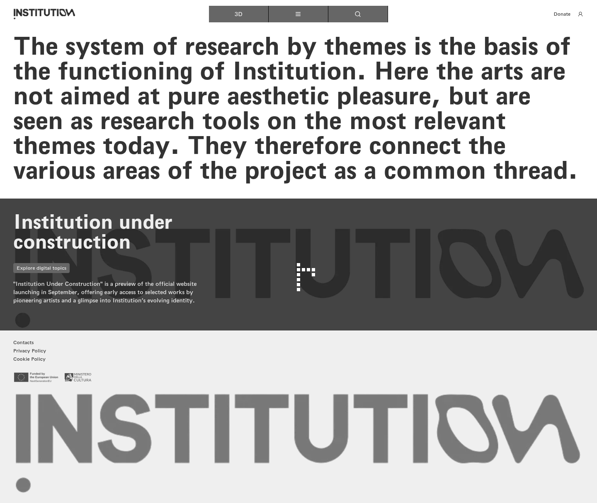
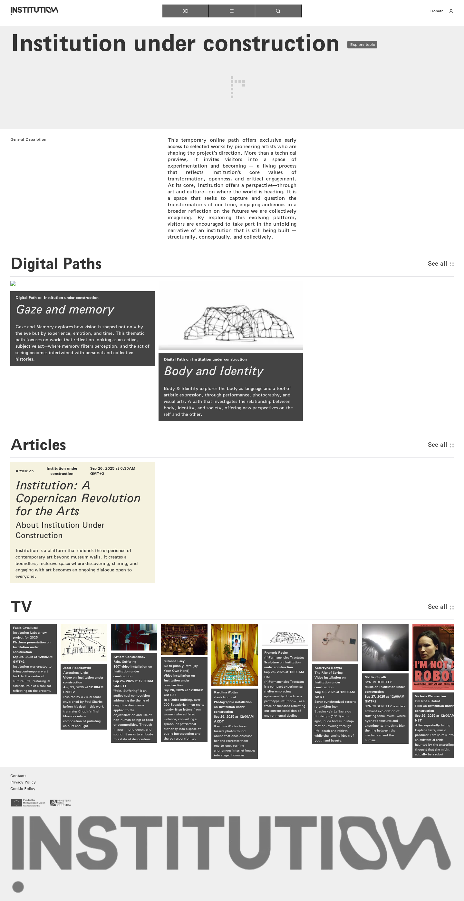
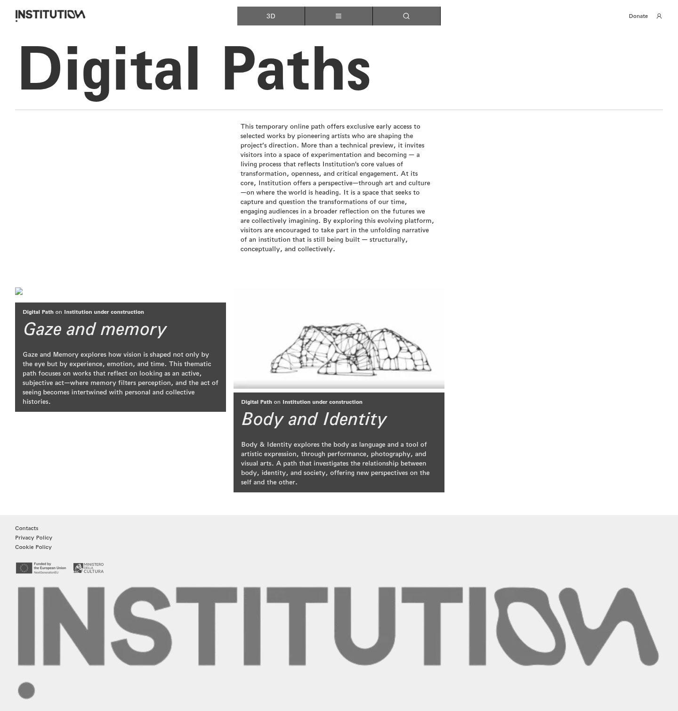
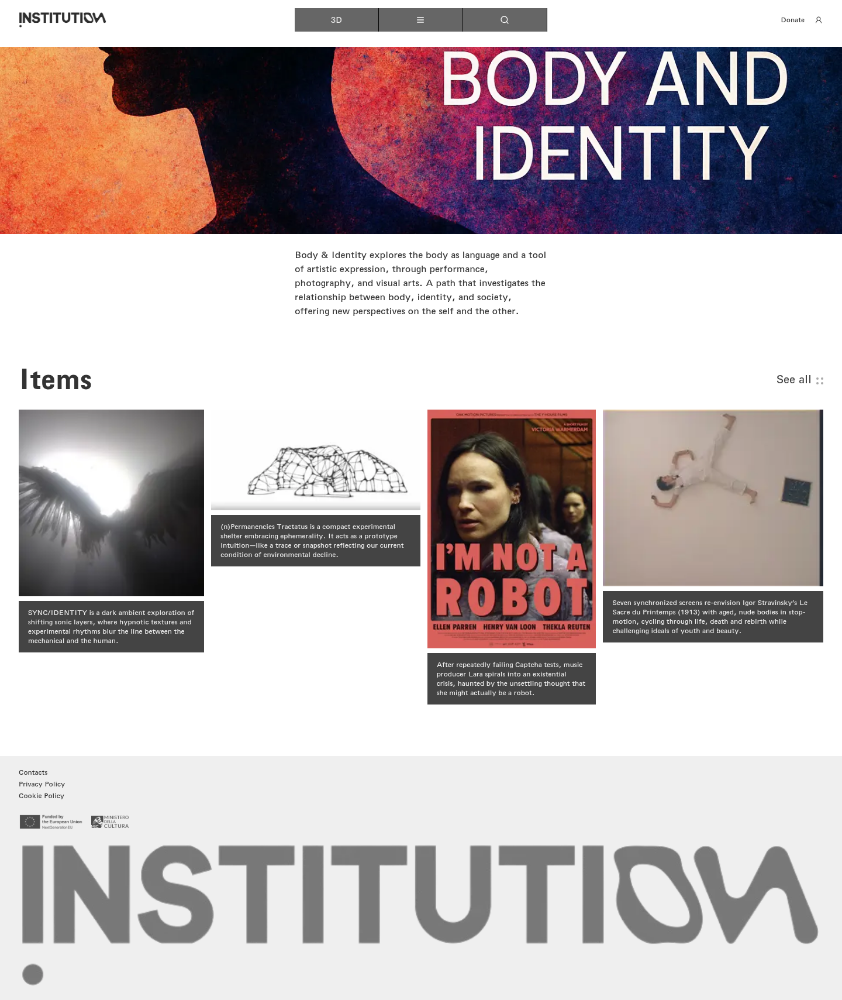
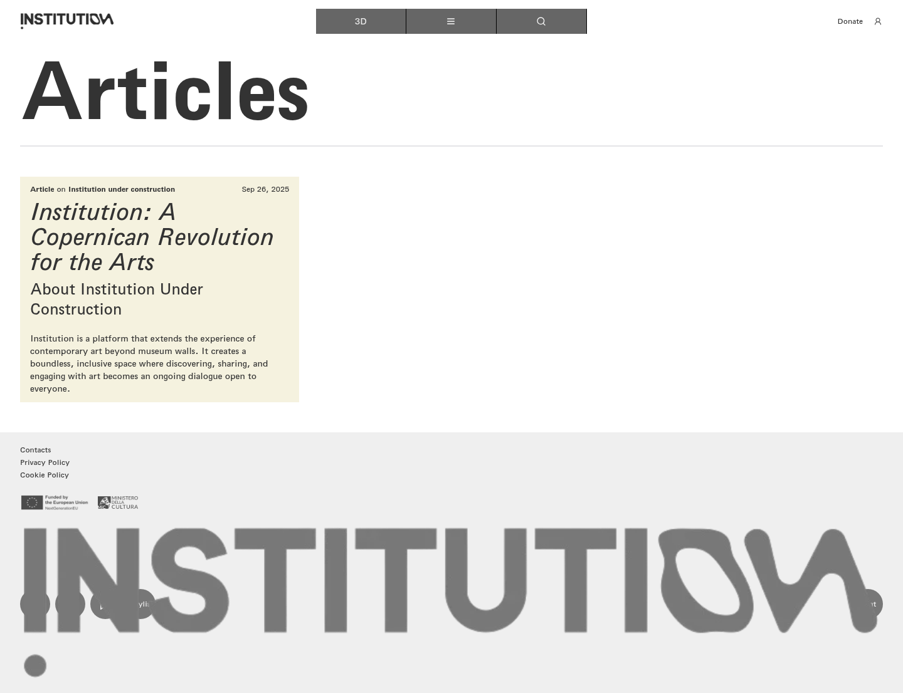
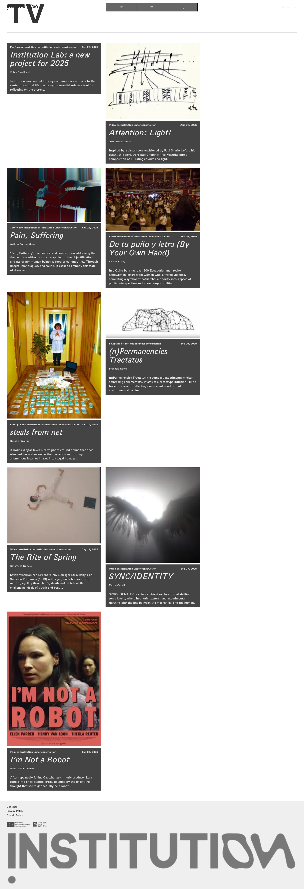

# 04｜主题与数字路径

[返回总目录](../README.md) · [上一章：搜索与地图移动](03-search.md) · [下一章：文章、作者与关联活动](05-articles.md)

**路线：** 主菜单 → Topics → 主题详情 → 数字路径或主题下文章／影像列表；每条支路返回主题详情后再进入。

> Figma 尚未取得，以下全部是网站实测。未编造设计画面；比较列保留“待匹配”。

## W022｜主题总览

- **用户操作：** 从导航选择 Topics（主题）。
- **操作后结果：** 显示主题介绍及 Institution under construction 主题卡片。
- **中文备注／不确定性：** 卡片 Explore digital topics 指向主题详情。
- **Figma：** 尚未取得设计画板，无法匹配。
- **来源：** 2026-10-16 网站实测，旧版证据编号 022。

[查看／下载原始截图](../screenshots/section-topics.png)

## W023｜主题详情：建设中的机构

- **用户操作：** 主题列表点击 Explore digital topics。
- **操作后结果：** 显示总述、两条数字路径、相关文章与 9 件影像作品。
- **中文备注／不确定性：** Explore topic 返回地图；每个 See all 指向对应列表，路径内还有独立的详情。
- **Figma：** 尚未取得设计画板，无法匹配。
- **来源：** 2026-10-16 网站实测，旧版证据编号 023。

[查看／下载原始截图](../screenshots/topic-detail.png)

## W024｜数字路径总览

- **用户操作：** 从主题详情的数字路径卡片或“查看全部”入口继续。
- **操作后结果：** 展示主题说明及“凝视与记忆”“身体与身份”两条数字路径卡片。
- **中文备注／不确定性：** 这里是数字路径总览，不是作品详情。两个路径卡片分别进入下列两个分支。
- **Figma：** 尚未取得设计画板，无法匹配。
- **来源：** 2026-10-16 网站实测，旧版证据编号 024。

[查看／下载原始截图](../screenshots/page-base-topics-1-digital-paths.png)

## W025｜凝视与记忆

- **用户操作：** 从主题详情的数字路径卡片或“查看全部”入口继续。
- **操作后结果：** 显示该路径的介绍和关联作品卡片。
- **中文备注／不确定性：** 关联作品指向已记录的影像或文章；保留长页面原图供逐段阅读。
- **Figma：** 尚未取得设计画板，无法匹配。
- **来源：** 2026-10-16 网站实测，旧版证据编号 025。

[查看／下载原始截图](../screenshots/page-base-topics-1-digital-paths-1.png)

## W026｜凝视与记忆：查看全部无变化

- **用户操作：** 点击数字路径中的 See all，等待 3.5 秒。
- **操作后结果：** 点击后 URL 与页面正文均与点击前相同。
- **中文备注／不确定性：** 链接地址为空；这次已完成可见控件点击并复核 sameURL=true、sameText=true。
- **Figma：** 尚未取得设计画板，无法匹配。
- **来源：** 2026-10-16 网站实测，旧版证据编号 027。

[查看／下载原始截图](../screenshots/see-all-1.png)

## W027｜身体与身份

- **用户操作：** 从主题详情的数字路径卡片或“查看全部”入口继续。
- **操作后结果：** 显示该路径的介绍和关联作品卡片。
- **中文备注／不确定性：** 关联作品指向已记录的影像或文章；保留长页面原图供逐段阅读。
- **Figma：** 尚未取得设计画板，无法匹配。
- **来源：** 2026-10-16 网站实测，旧版证据编号 026。

[查看／下载原始截图](../screenshots/page-base-topics-1-digital-paths-3.png)

## W028｜身体与身份：查看全部无变化

- **用户操作：** 点击数字路径中的 See all，等待 3.5 秒。
- **操作后结果：** 点击后 URL 与页面正文均与点击前相同。
- **中文备注／不确定性：** 链接地址为空；这次已完成可见控件点击并复核 sameURL=true、sameText=true。
- **Figma：** 尚未取得设计画板，无法匹配。
- **来源：** 2026-10-16 网站实测，旧版证据编号 028。

[查看／下载原始截图](../screenshots/see-all-3.png)

## W029｜主题下的文章列表

- **用户操作：** 点击主题详情中相应 See all（查看全部）入口。
- **操作后结果：** 显示当前主题关联的内容列表。
- **中文备注／不确定性：** 与全站列表入口分开记录，便于核对导航层级。
- **Figma：** 尚未取得设计画板，无法匹配。
- **来源：** 2026-10-16 网站实测，旧版证据编号 033。

[查看／下载原始截图](../screenshots/page-base-articles-topic-articles-1.png)

## W030｜主题下的影像列表

- **用户操作：** 点击主题详情中相应 See all（查看全部）入口。
- **操作后结果：** 显示当前主题关联的内容列表。
- **中文备注／不确定性：** 与全站列表入口分开记录，便于核对导航层级。
- **Figma：** 尚未取得设计画板，无法匹配。
- **来源：** 2026-10-16 网站实测，旧版证据编号 035。

[查看／下载原始截图](../screenshots/page-base-tv-topic-tv-1.png)

---

[返回总目录](../README.md) · [上一章：搜索与地图移动](03-search.md) · [下一章：文章、作者与关联活动](05-articles.md)
