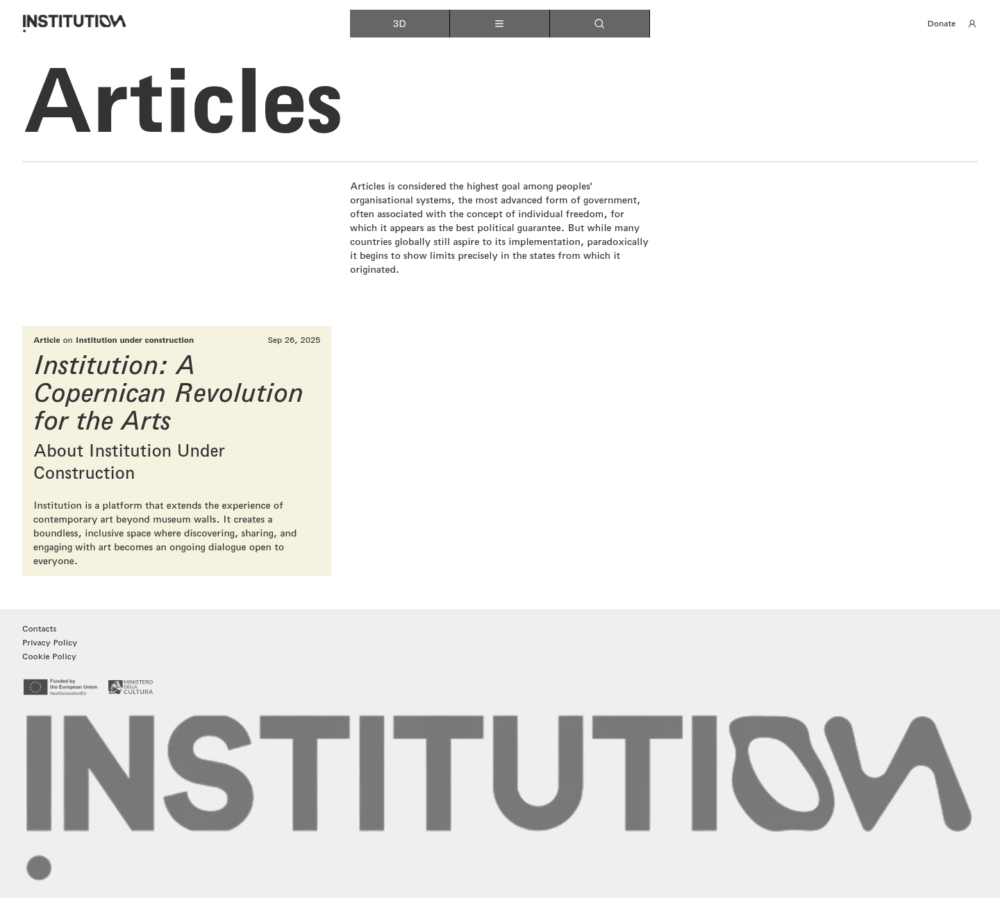
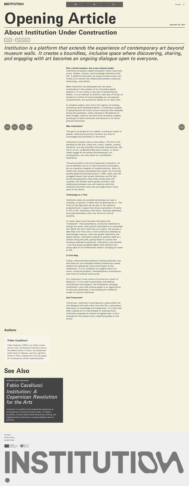
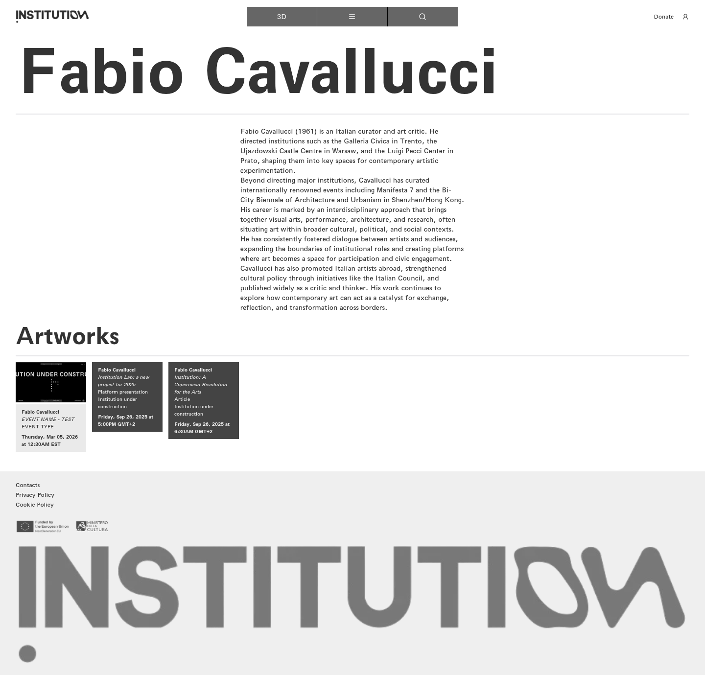
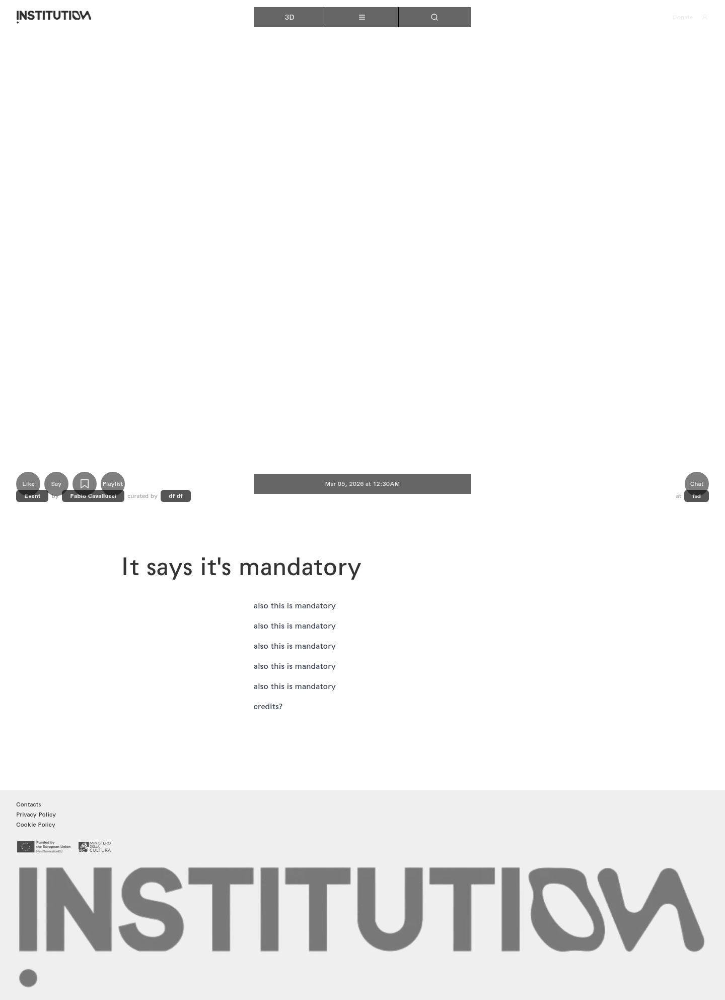

# 05｜文章、作者与关联活动

[返回总目录](../README.md) · [上一章：主题与数字路径](04-topics.md) · [下一章：作品总览](06-tv-list.md)

**路线：** 主菜单 → Articles → 文章详情 → 作者介绍 → 关联测试活动。

> Figma 尚未取得，以下全部是网站实测。未编造设计画面；比较列保留“待匹配”。

## W031｜文章总览

- **用户操作：** 从导航选择 Articles（文章）。
- **操作后结果：** 显示说明文字与一篇机构文章。
- **中文备注／不确定性：** 说明开头使用 Articles，后续正文仍讨论民主；这是当时内容，未代替网站修正。
- **Figma：** 尚未取得设计画板，无法匹配。
- **来源：** 2026-10-16 网站实测，旧版证据编号 029。

[查看／下载原始截图](../screenshots/section-articles.png)

## W032｜完整文章：机构的艺术变革

- **用户操作：** 从文章列表点击文章卡片。
- **操作后结果：** 展示正文、作者介绍、关联内容与底部互动栏。
- **中文备注／不确定性：** 赞、评论、保存、播放列表、聊天在当前未登录状态均为禁用。
- **Figma：** 尚未取得设计画板，无法匹配。
- **来源：** 2026-10-16 网站实测，旧版证据编号 030。

[查看／下载原始截图](../screenshots/article-detail.png)

## W033｜作者详情：Fabio Cavallucci

- **用户操作：** 文章详情点击作者卡片。
- **操作后结果：** 显示作者生平和三条关联作品／活动。
- **中文备注／不确定性：** 其中 EVENT NAME - TEST 指向测试活动页面，单独记录其内容。
- **Figma：** 尚未取得设计画板，无法匹配。
- **来源：** 2026-10-16 网站实测，旧版证据编号 031。

[查看／下载原始截图](../screenshots/page-base-artist-7.png)

## W034｜活动详情：测试活动

- **用户操作：** 从作者详情点击 EVENT NAME - TEST。
- **操作后结果：** 页面含测试文案、策展与地点占位内容。
- **中文备注／不确定性：** 该页面存在测试数据，不将其改写为正式活动信息。互动栏在未登录状态禁用。
- **Figma：** 尚未取得设计画板，无法匹配。
- **来源：** 2026-10-16 网站实测，旧版证据编号 032。

[查看／下载原始截图](../screenshots/page-base-events-22.png)

---

[返回总目录](../README.md) · [上一章：主题与数字路径](04-topics.md) · [下一章：作品总览](06-tv-list.md)
