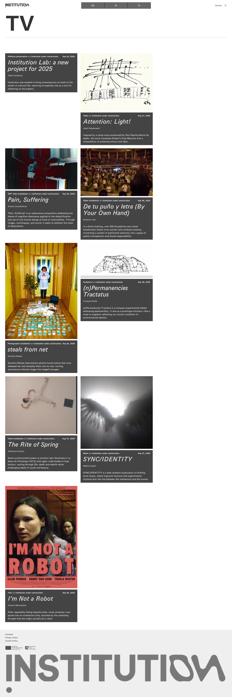

# 06｜作品总览

[返回总目录](../README.md) · [上一章：文章、作者与关联活动](05-articles.md) · [下一章：机构实验室：2025 年的新项目](07-work-12.md)

**路线：** 主菜单 → TV；下列九个章节分别从同一列表进入各作品。

> Figma 尚未取得，以下全部是网站实测。未编造设计画面；比较列保留“待匹配”。

## W035｜影像／作品总览

- **用户操作：** 从导航选择 TV。
- **操作后结果：** 显示 9 件作品的类型、主题、日期、作者及简介。
- **中文备注／不确定性：** 每张卡片都有独立详情页，下文逐一展开。
- **Figma：** 尚未取得设计画板，无法匹配。
- **来源：** 2026-10-16 网站实测，旧版证据编号 034。

[查看／下载原始截图](../screenshots/section-tv.png)

---

[返回总目录](../README.md) · [上一章：文章、作者与关联活动](05-articles.md) · [下一章：机构实验室：2025 年的新项目](07-work-12.md)
