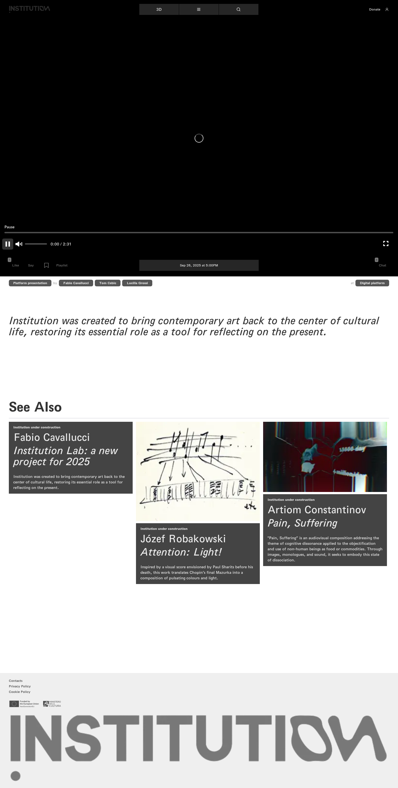
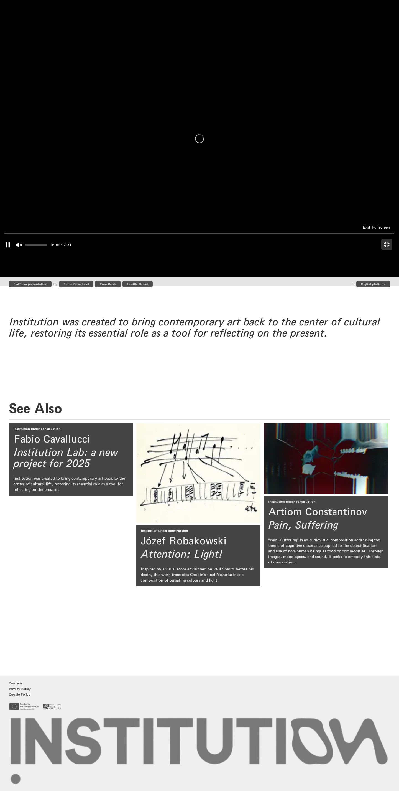

# 07｜机构实验室：2025 年的新项目

[返回总目录](../README.md) · [上一章：作品总览](06-tv-list.md) · [下一章：注意：光！](08-work-5.md)

**路线：** 从作品列表点击该作品；依次记录详情、播放、静音、全屏。切换作品前返回列表。

> Figma 尚未取得，以下全部是网站实测。未编造设计画面；比较列保留“待匹配”。

## W036｜作品详情：机构实验室：2025 年的新项目

- **用户操作：** 在 TV 列表点击该作品卡片（编号 12）。
- **操作后结果：** 显示播放器、作者、发布时间、作品介绍和相关推荐。
- **中文备注／不确定性：** 下方互动按钮当前禁用；播放器的播放、静音及全屏另行截图。
- **Figma：** 尚未取得设计画板，无法匹配。
- **来源：** 2026-10-16 网站实测，旧版证据编号 036。

[查看／下载原始截图](../screenshots/tv-12.png)

## W037｜《机构实验室：2025 年的新项目》：播放

- **用户操作：** 进入作品详情，点击播放控件。
- **操作后结果：** 已点击播放器播放控件并保存页面状态；该页使用嵌入式播放器。
- **中文备注／不确定性：** 没有取得原生 video 的时间状态，无法仅据该次截图确认视频已实际播放；保留为“已操作、播放结果未确认”。
- **Figma：** 尚未取得设计画板，无法匹配。
- **来源：** 2026-10-16 网站实测，旧版证据编号 037。

[查看／下载原始截图](../screenshots/media-12-play.png)

## W038｜《机构实验室：2025 年的新项目》：静音

- **用户操作：** 进入作品详情，点击静音控件。
- **操作后结果：** 记录播放器或控件变化后的页面。
- **中文备注／不确定性：** 播放成功与否以播放时间、paused、readyState 或画面为证，不把出现播放器本身当作播放成功。
- **Figma：** 尚未取得设计画板，无法匹配。
- **来源：** 2026-10-16 网站实测，旧版证据编号 038。

[查看／下载原始截图](../screenshots/media-12-mute.png)

## W039｜《机构实验室：2025 年的新项目》：全屏

- **用户操作：** 进入作品详情，点击全屏控件。
- **操作后结果：** 记录播放器或控件变化后的页面。
- **中文备注／不确定性：** 播放成功与否以播放时间、paused、readyState 或画面为证，不把出现播放器本身当作播放成功。
- **Figma：** 尚未取得设计画板，无法匹配。
- **来源：** 2026-10-16 网站实测，旧版证据编号 039。

[查看／下载原始截图](../screenshots/media-12-fullscreen.png)

---

[返回总目录](../README.md) · [上一章：作品总览](06-tv-list.md) · [下一章：注意：光！](08-work-5.md)
