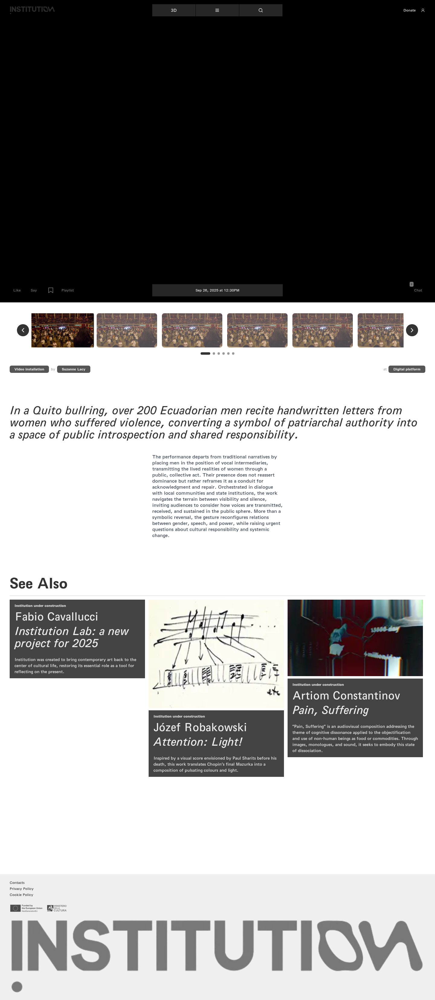
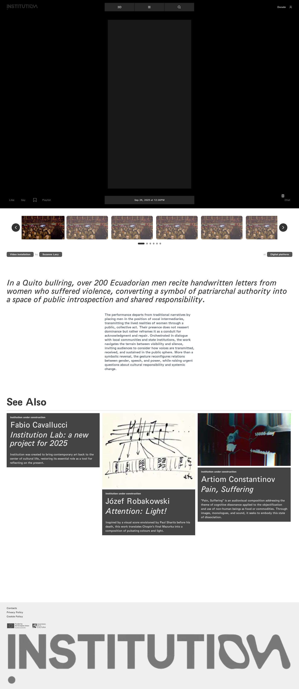
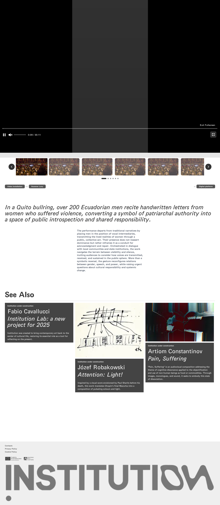

# 10｜以你亲手所写

[返回总目录](../README.md) · [上一章：痛苦与苦难](09-work-10.md) · [下一章：从网络中偷来](11-work-14.md)

**路线：** 从作品列表点击该作品；依次记录详情、播放、静音、全屏。切换作品前返回列表。

> Figma 尚未取得，以下全部是网站实测。未编造设计画面；比较列保留“待匹配”。

## W048｜作品详情：以你亲手所写

- **用户操作：** 在 TV 列表点击该作品卡片（编号 9）。
- **操作后结果：** 显示播放器、作者、发布时间、作品介绍和相关推荐。
- **中文备注／不确定性：** 下方互动按钮当前禁用；播放器的播放、静音及全屏另行截图。
- **Figma：** 尚未取得设计画板，无法匹配。
- **来源：** 2026-10-16 网站实测，旧版证据编号 048。

[查看／下载原始截图](../screenshots/tv-9.png)

## W049｜《以你亲手所写》：播放

- **用户操作：** 进入作品详情，点击播放控件。
- **操作后结果：** 原生视频在采样时 paused=false，播放时间约 5.01 秒，readyState=4。
- **中文备注／不确定性：** 这些状态支持“播放已开始”，不代表完整播放至结束。未记录到视频错误。
- **Figma：** 尚未取得设计画板，无法匹配。
- **来源：** 2026-10-16 网站实测，旧版证据编号 049。

[查看／下载原始截图](../screenshots/media-9-play.png)

## W050｜《以你亲手所写》：静音

- **用户操作：** 进入作品详情，点击静音控件。
- **操作后结果：** 记录播放器或控件变化后的页面。
- **中文备注／不确定性：** 播放成功与否以播放时间、paused、readyState 或画面为证，不把出现播放器本身当作播放成功。
- **Figma：** 尚未取得设计画板，无法匹配。
- **来源：** 2026-10-16 网站实测，旧版证据编号 050。

[查看／下载原始截图](../screenshots/media-9-mute.png)

## W051｜《以你亲手所写》：全屏

- **用户操作：** 进入作品详情，点击全屏控件。
- **操作后结果：** 记录播放器或控件变化后的页面。
- **中文备注／不确定性：** 播放成功与否以播放时间、paused、readyState 或画面为证，不把出现播放器本身当作播放成功。
- **Figma：** 尚未取得设计画板，无法匹配。
- **来源：** 2026-10-16 网站实测，旧版证据编号 051。

[查看／下载原始截图](../screenshots/media-9-fullscreen.png)

---

[返回总目录](../README.md) · [上一章：痛苦与苦难](09-work-10.md) · [下一章：从网络中偷来](11-work-14.md)
