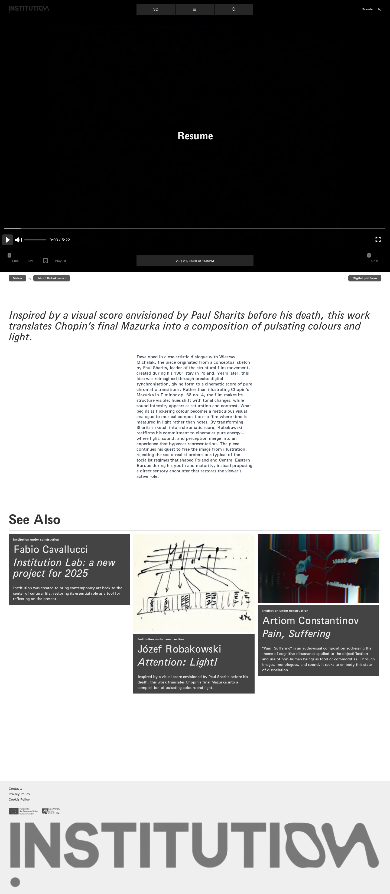
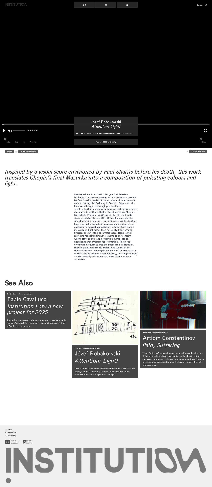

# 16｜播放器补充操作

[返回总目录](../README.md) · [上一章：我不是机器人](15-work-13.md) · [下一章：日历筛选与日期](17-calendar.md)

**路线：** 在《注意：光！》演示暂停、全屏、退出全屏和日期按钮；这不是九件作品逐一做了全部补充检查。

> Figma 尚未取得，以下全部是网站实测。未编造设计画面；比较列保留“待匹配”。

## W072｜暂停视频

- **用户操作：** 播放《注意：光！》后点击 Pause。
- **操作后结果：** 暂停控件与播放状态发生变化。
- **中文备注／不确定性：** 暂停证据来自 video.paused 与当前播放时间。
- **Figma：** 尚未取得设计画板，无法匹配。
- **来源：** 2026-10-16 网站实测，旧版证据编号 072。

[查看／下载原始截图](../screenshots/media-pause.png)

## W073｜进入视频全屏

- **用户操作：** 点击 Fullscreen。
- **操作后结果：** 播放器进入全屏状态。
- **中文备注／不确定性：** 通过 document.fullscreenElement 确认，不仅依赖图片外观。
- **Figma：** 尚未取得设计画板，无法匹配。
- **来源：** 2026-10-16 网站实测，旧版证据编号 073。

[查看／下载原始截图](../screenshots/media-fullscreen-confirmed.png)

## W074｜退出视频全屏

- **用户操作：** 通过浏览器全屏接口退出全屏。
- **操作后结果：** document.fullscreenElement 变为 false，页面恢复普通布局。
- **中文备注／不确定性：** 先前日期测试被覆盖层遮挡；本次退出并复测成功，不归为网站无响应。
- **Figma：** 尚未取得设计画板，无法匹配。
- **来源：** 2026-10-16 网站实测，旧版证据编号 074。

[查看／下载原始截图](../screenshots/media-exit-fullscreen.png)

## W075｜作品日期按钮：展开作品卡片

- **用户操作：** 在普通页面点击 Aug 21, 2025 at 1:30PM。
- **操作后结果：** 展开含作者、作品标题、计数、类型、主题与 Scroll to read 的作品浮层。
- **中文备注／不确定性：** 日期按钮实际打开作品信息卡，不是时区选择器；图片记录真实交互结果。
- **Figma：** 尚未取得设计画板，无法匹配。
- **来源：** 2026-10-16 网站实测，旧版证据编号 075。

[查看／下载原始截图](../screenshots/media-date-timezone.png)

---

[返回总目录](../README.md) · [上一章：我不是机器人](15-work-13.md) · [下一章：日历筛选与日期](17-calendar.md)
