# 17｜日历筛选与日期

[返回总目录](../README.md) · [上一章：播放器补充操作](16-player.md) · [下一章：其他栏目与机构信息](18-sections.md)

**路线：** 主菜单 → Calendar。类型／主题条件可同时保留；自选日期的补充截图在其对应操作后排列。

> Figma 尚未取得，以下全部是网站实测。未编造设计画面；比较列保留“待匹配”。

## W076｜日历初始状态

- **用户操作：** 从导航选择 Calendar（日历）。
- **操作后结果：** 左侧按主题、类型、时间筛选，右侧列出内容卡片。
- **中文备注／不确定性：** 筛选项在后续分镜逐项记录；时间筛选为空可能是历史内容与当前日期不匹配。
- **Figma：** 尚未取得设计画板，无法匹配。
- **来源：** 2026-10-16 网站实测，旧版证据编号 076。

[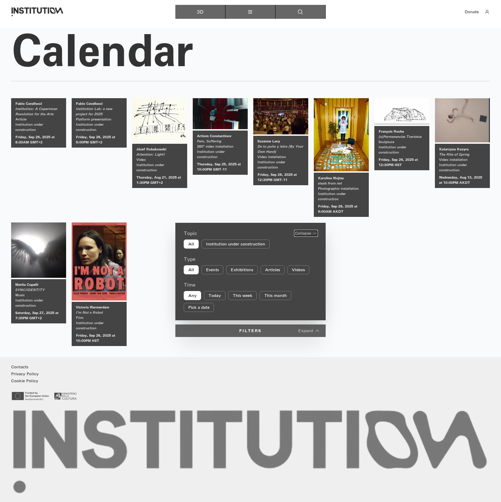](../screenshots/section-calendar.png)

[查看／下载原始截图](../screenshots/section-calendar.png)

## W077｜日历筛选：建设中的机构主题

- **用户操作：** 在日历按顺序点击“建设中的机构主题”对应控件。
- **操作后结果：** 结果区域显示当前筛选下的内容；具体卡片见截图。
- **中文备注／不确定性：** 此组为连续筛选流程，前一个类型／主题选择可能仍保留；不是每次重置全部筛选。
- **Figma：** 尚未取得设计画板，无法匹配。
- **来源：** 2026-10-16 网站实测，旧版证据编号 077。

[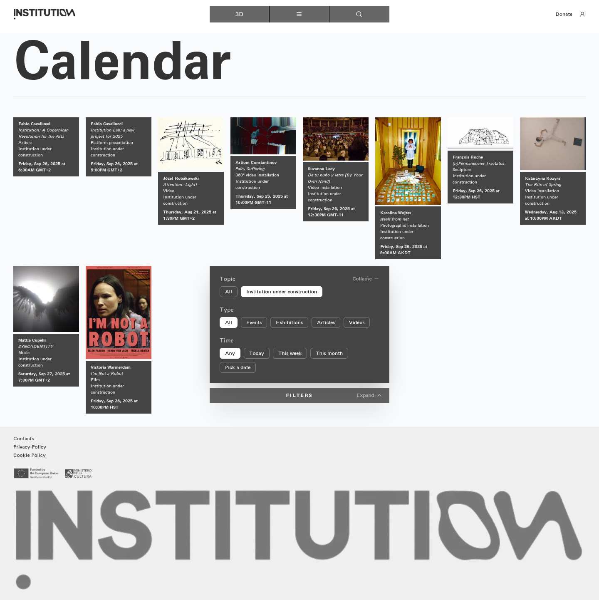](../screenshots/cal-institution-under-construction.png)

[查看／下载原始截图](../screenshots/cal-institution-under-construction.png)

## W078｜日历筛选：类型不限

- **用户操作：** 在日历按顺序点击“类型不限”对应控件。
- **操作后结果：** 结果区域显示当前筛选下的内容；具体卡片见截图。
- **中文备注／不确定性：** 此组为连续筛选流程，前一个类型／主题选择可能仍保留；不是每次重置全部筛选。
- **Figma：** 尚未取得设计画板，无法匹配。
- **来源：** 2026-10-16 网站实测，旧版证据编号 078。

[查看／下载原始截图](../screenshots/cal-all.png)

## W079｜日历筛选：活动类型

- **用户操作：** 在日历按顺序点击“活动类型”对应控件。
- **操作后结果：** 结果区域显示“没有匹配筛选条件的活动”。
- **中文备注／不确定性：** 此组为连续筛选流程，前一个类型／主题选择可能仍保留；不是每次重置全部筛选。
- **Figma：** 尚未取得设计画板，无法匹配。
- **来源：** 2026-10-16 网站实测，旧版证据编号 079。

[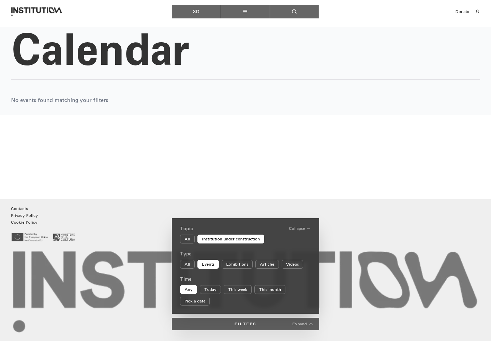](../screenshots/cal-events.png)

[查看／下载原始截图](../screenshots/cal-events.png)

## W080｜日历筛选：展览类型

- **用户操作：** 在日历按顺序点击“展览类型”对应控件。
- **操作后结果：** 结果区域显示“没有匹配筛选条件的活动”。
- **中文备注／不确定性：** 此组为连续筛选流程，前一个类型／主题选择可能仍保留；不是每次重置全部筛选。
- **Figma：** 尚未取得设计画板，无法匹配。
- **来源：** 2026-10-16 网站实测，旧版证据编号 080。

[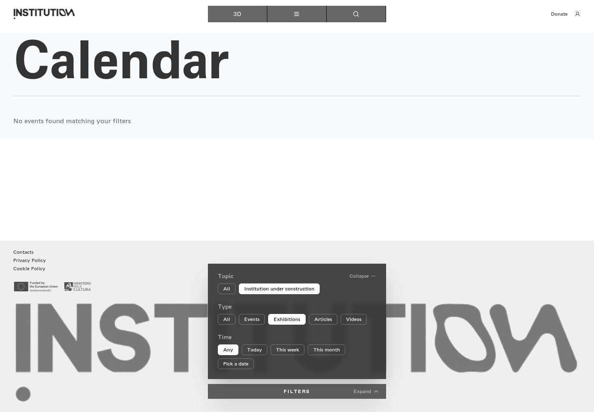](../screenshots/cal-exhibitions.png)

[查看／下载原始截图](../screenshots/cal-exhibitions.png)

## W081｜日历筛选：文章类型

- **用户操作：** 在日历按顺序点击“文章类型”对应控件。
- **操作后结果：** 结果区域显示当前筛选下的内容；具体卡片见截图。
- **中文备注／不确定性：** 此组为连续筛选流程，前一个类型／主题选择可能仍保留；不是每次重置全部筛选。
- **Figma：** 尚未取得设计画板，无法匹配。
- **来源：** 2026-10-16 网站实测，旧版证据编号 081。

[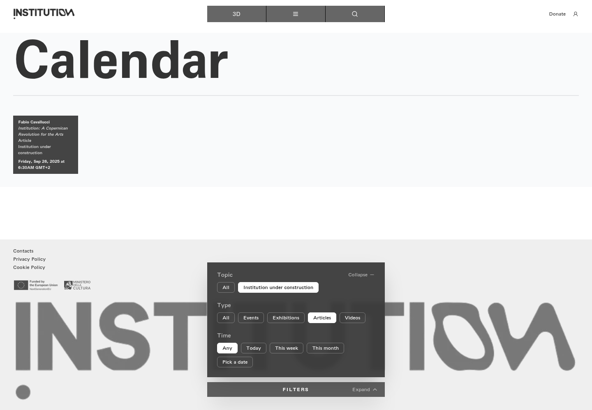](../screenshots/cal-articles.png)

[查看／下载原始截图](../screenshots/cal-articles.png)

## W082｜日历筛选：视频类型

- **用户操作：** 在日历按顺序点击“视频类型”对应控件。
- **操作后结果：** 结果区域显示当前筛选下的内容；具体卡片见截图。
- **中文备注／不确定性：** 此组为连续筛选流程，前一个类型／主题选择可能仍保留；不是每次重置全部筛选。
- **Figma：** 尚未取得设计画板，无法匹配。
- **来源：** 2026-10-16 网站实测，旧版证据编号 082。

[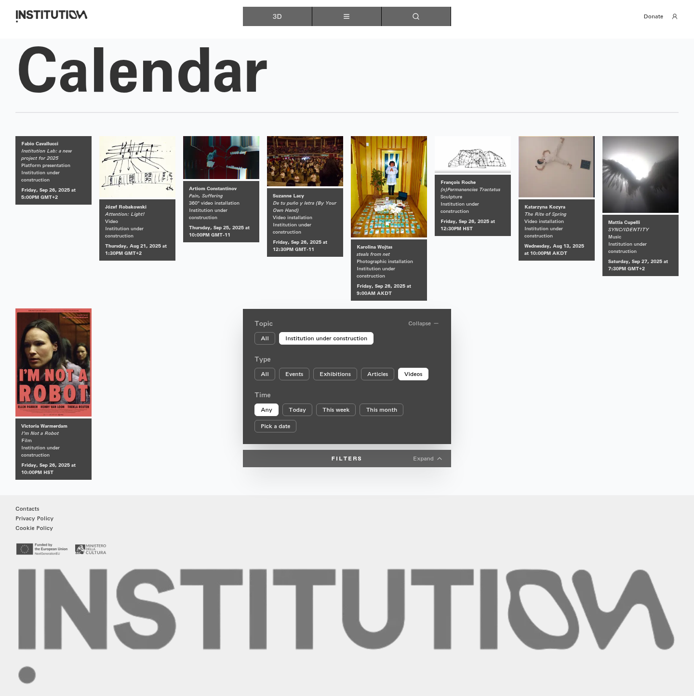](../screenshots/cal-videos.png)

[查看／下载原始截图](../screenshots/cal-videos.png)

## W083｜日历筛选：时间不限

- **用户操作：** 在日历按顺序点击“时间不限”对应控件。
- **操作后结果：** 结果区域显示当前筛选下的内容；具体卡片见截图。
- **中文备注／不确定性：** 此组为连续筛选流程，前一个类型／主题选择可能仍保留；不是每次重置全部筛选。
- **Figma：** 尚未取得设计画板，无法匹配。
- **来源：** 2026-10-16 网站实测，旧版证据编号 083。

[查看／下载原始截图](../screenshots/cal-any.png)

## W084｜日历筛选：今天

- **用户操作：** 在日历按顺序点击“今天”对应控件。
- **操作后结果：** 结果区域显示“没有匹配筛选条件的活动”。
- **中文备注／不确定性：** 此组为连续筛选流程，前一个类型／主题选择可能仍保留；不是每次重置全部筛选。
- **Figma：** 尚未取得设计画板，无法匹配。
- **来源：** 2026-10-16 网站实测，旧版证据编号 084。

[查看／下载原始截图](../screenshots/cal-today.png)

## W085｜日历筛选：本周

- **用户操作：** 在日历按顺序点击“本周”对应控件。
- **操作后结果：** 结果区域显示“没有匹配筛选条件的活动”。
- **中文备注／不确定性：** 此组为连续筛选流程，前一个类型／主题选择可能仍保留；不是每次重置全部筛选。
- **Figma：** 尚未取得设计画板，无法匹配。
- **来源：** 2026-10-16 网站实测，旧版证据编号 085。

[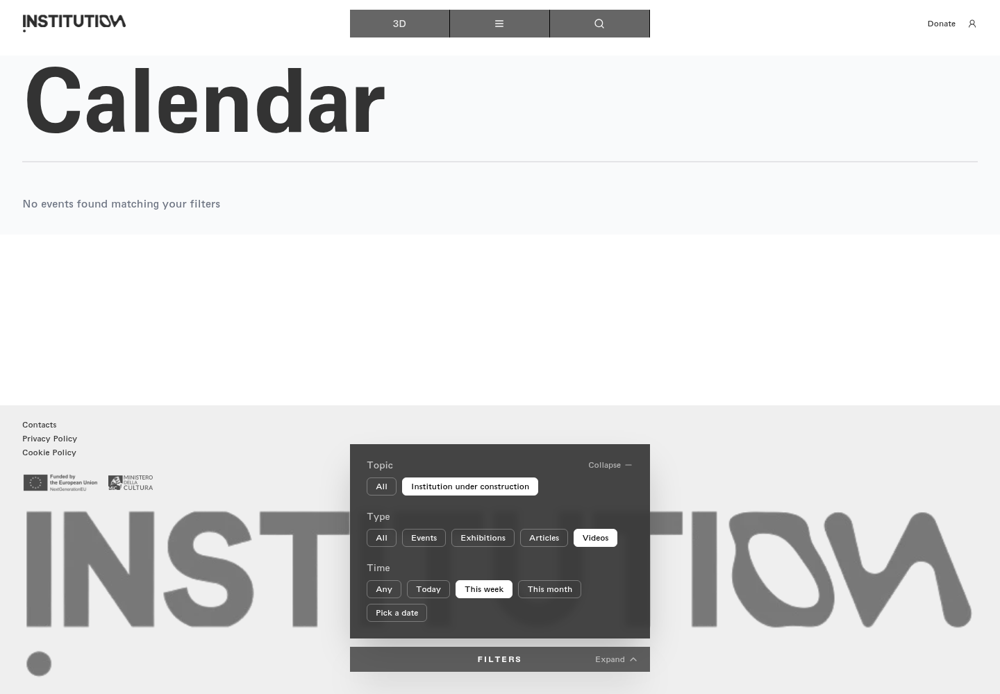](../screenshots/cal-this-week.png)

[查看／下载原始截图](../screenshots/cal-this-week.png)

## W086｜日历筛选：本月

- **用户操作：** 在日历按顺序点击“本月”对应控件。
- **操作后结果：** 结果区域显示“没有匹配筛选条件的活动”。
- **中文备注／不确定性：** 此组为连续筛选流程，前一个类型／主题选择可能仍保留；不是每次重置全部筛选。
- **Figma：** 尚未取得设计画板，无法匹配。
- **来源：** 2026-10-16 网站实测，旧版证据编号 086。

[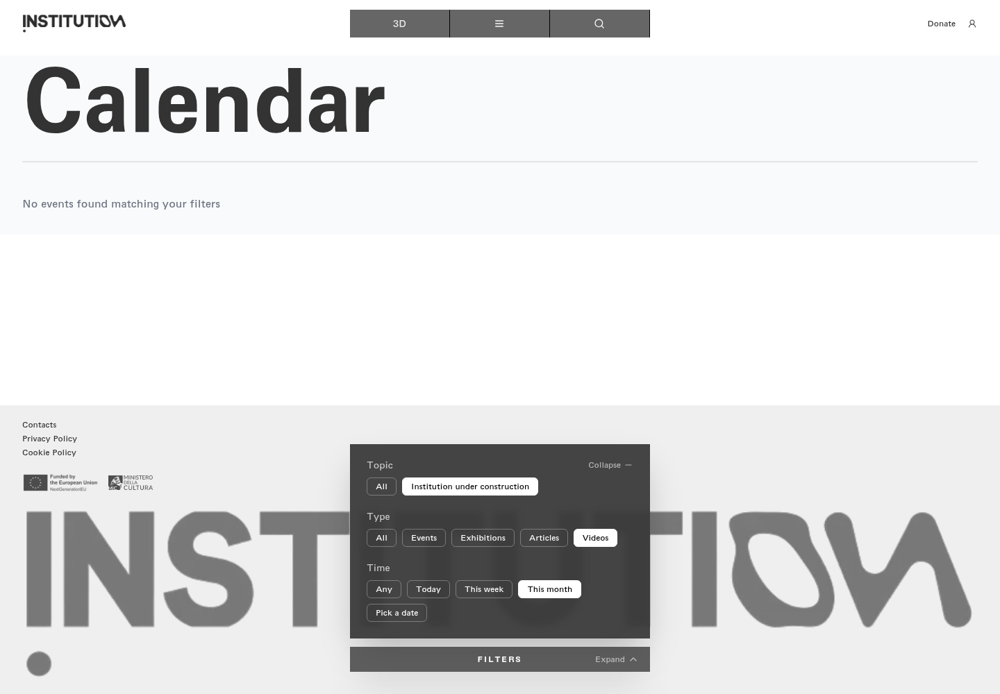](../screenshots/cal-this-month.png)

[查看／下载原始截图](../screenshots/cal-this-month.png)

## W087｜日历筛选：自选日期

- **用户操作：** 在日历按顺序点击“自选日期”对应控件。
- **操作后结果：** 结果区域显示当前筛选下的内容；具体卡片见截图。
- **中文备注／不确定性：** 此组为连续筛选流程，前一个类型／主题选择可能仍保留；不是每次重置全部筛选。
- **Figma：** 尚未取得设计画板，无法匹配。
- **来源：** 2026-10-16 网站实测，旧版证据编号 087。

[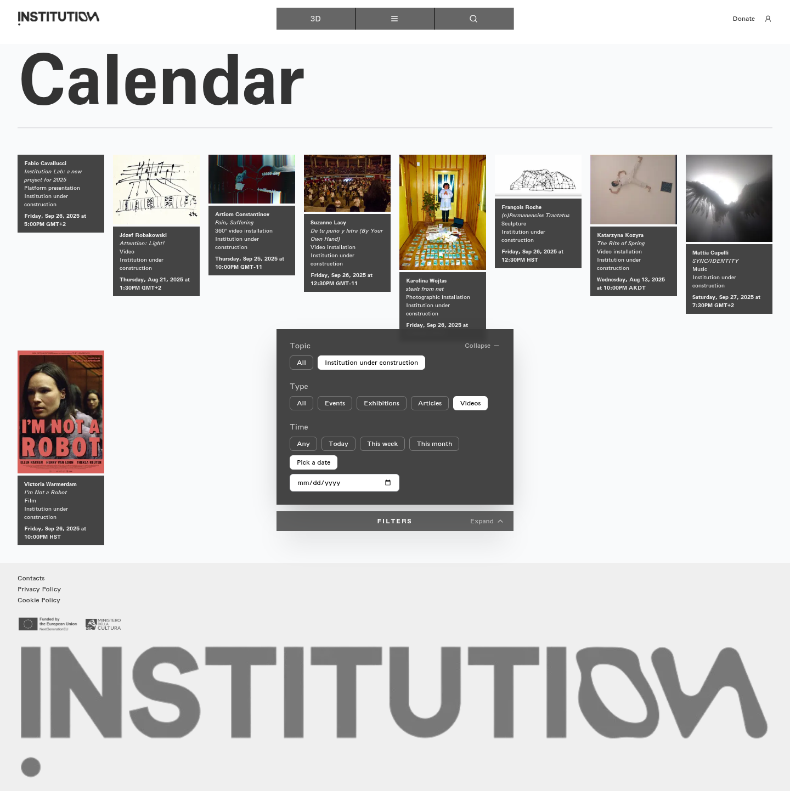](../screenshots/cal-pick-a-date.png)

[查看／下载原始截图](../screenshots/cal-pick-a-date.png)

## W088｜日历自选日期字段

- **用户操作：** 点击 Pick a date。
- **操作后结果：** 显示日期输入字段；原生日期选择器可能由浏览器绘制。
- **中文备注／不确定性：** 选日期与浏览器原生弹窗分开说明。
- **Figma：** 尚未取得设计画板，无法匹配。
- **来源：** 2026-10-16 网站实测，旧版证据编号 152。

[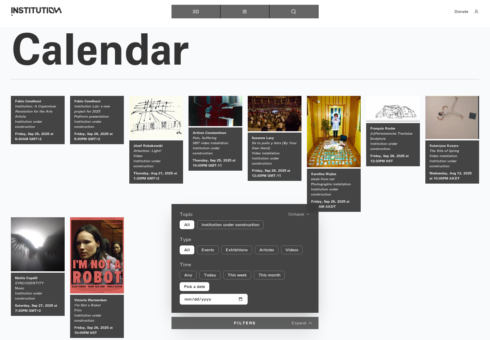](../screenshots/calendar-date-input.png)

[查看／下载原始截图](../screenshots/calendar-date-input.png)

## W089｜日历按指定日期筛选

- **用户操作：** 在日期字段选择 2025-09-26。
- **操作后结果：** 保存日期条件作用后的内容列表。
- **中文备注／不确定性：** 该日期用于匹配站点历史内容，不是当前日期。
- **Figma：** 尚未取得设计画板，无法匹配。
- **来源：** 2026-10-16 网站实测，旧版证据编号 153。

[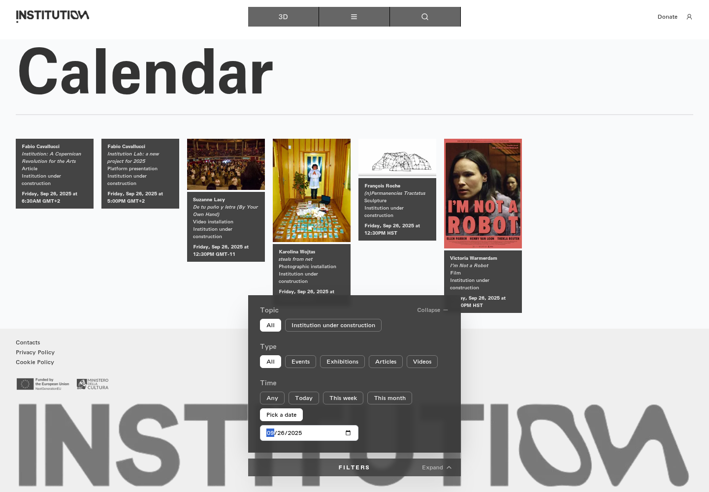](../screenshots/calendar-picked-date.png)

[查看／下载原始截图](../screenshots/calendar-picked-date.png)

## W090｜日历筛选：收起筛选

- **用户操作：** 在日历按顺序点击“收起筛选”对应控件。
- **操作后结果：** 筛选选项收起，仅保留 FILTERS 入口和结果区域。
- **中文备注／不确定性：** 此组为连续筛选流程，前一个类型／主题选择可能仍保留；不是每次重置全部筛选。
- **Figma：** 尚未取得设计画板，无法匹配。
- **来源：** 2026-10-16 网站实测，旧版证据编号 088。

[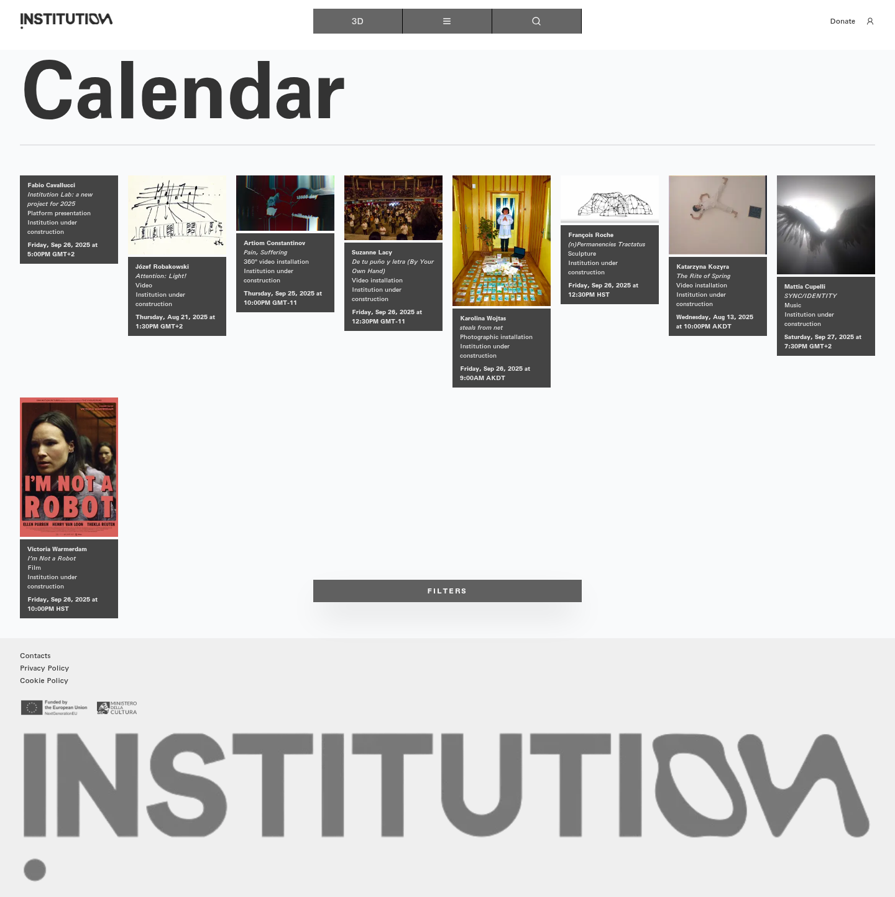](../screenshots/cal-collapse.png)

[查看／下载原始截图](../screenshots/cal-collapse.png)

---

[返回总目录](../README.md) · [上一章：播放器补充操作](16-player.md) · [下一章：其他栏目与机构信息](18-sections.md)
