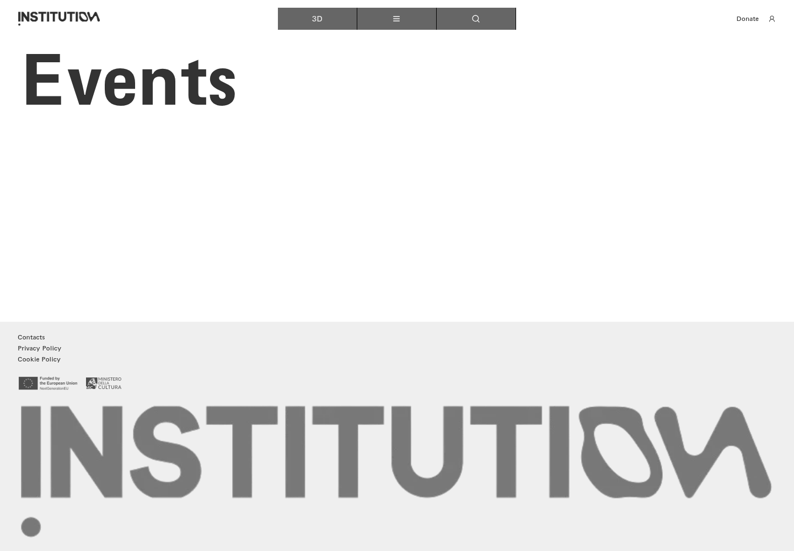
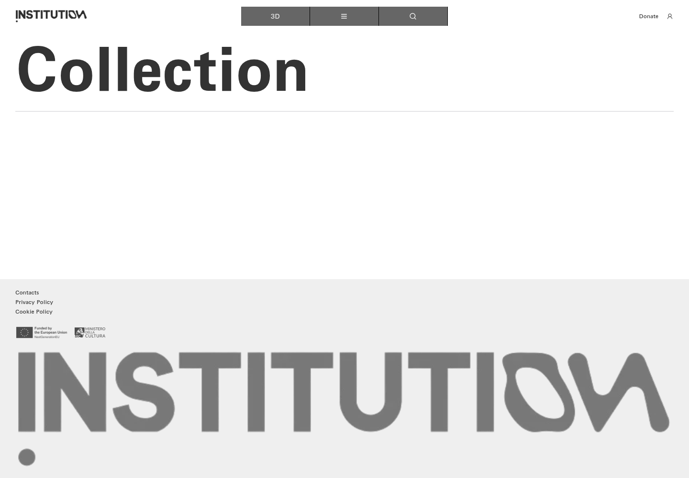
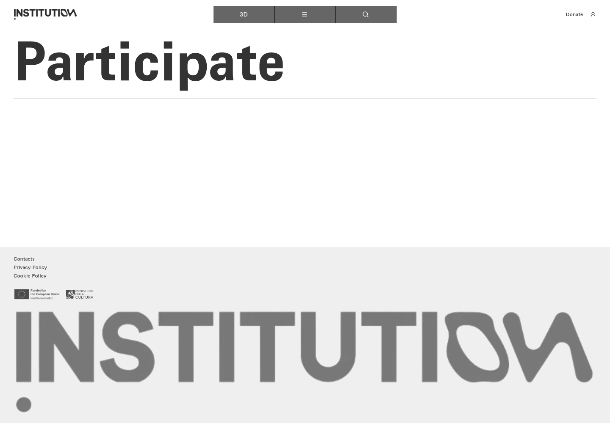
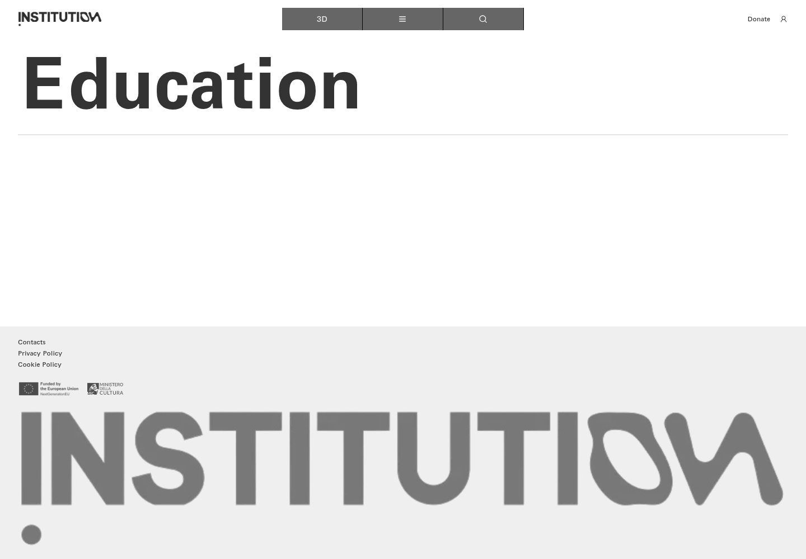
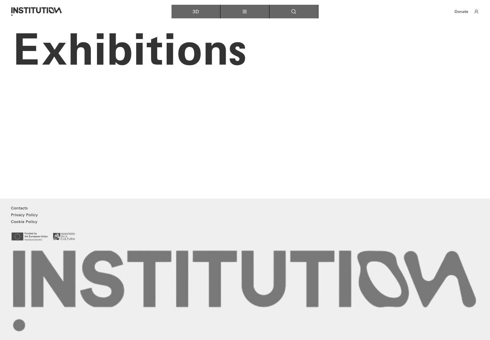
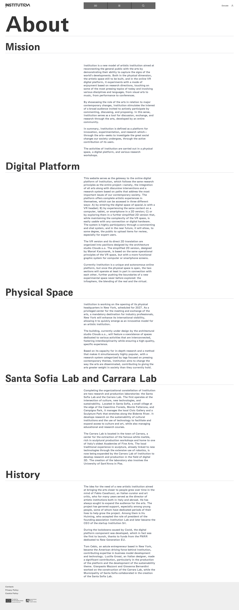
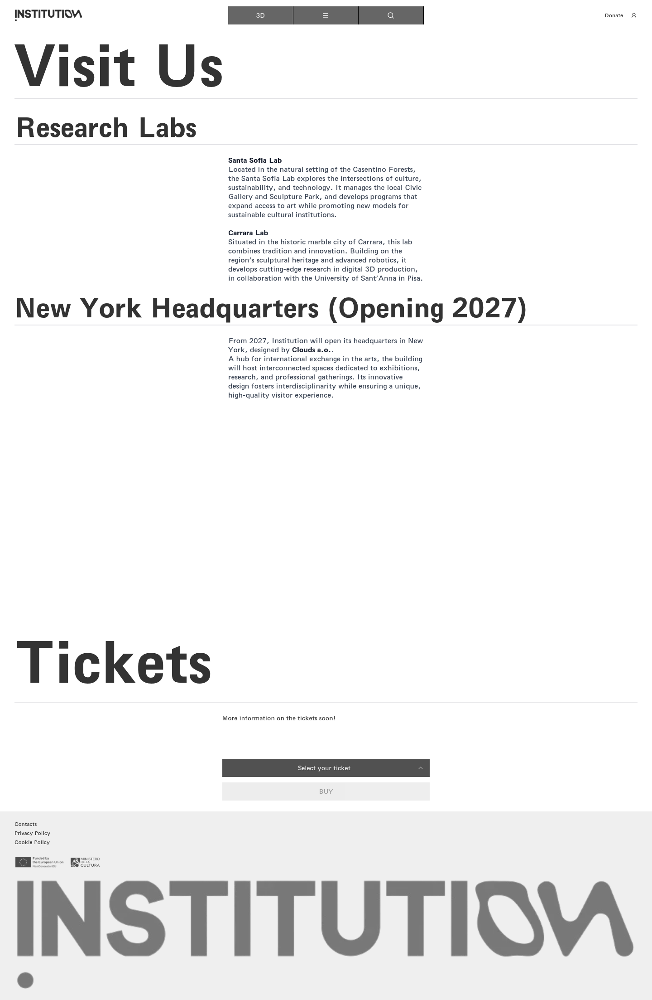
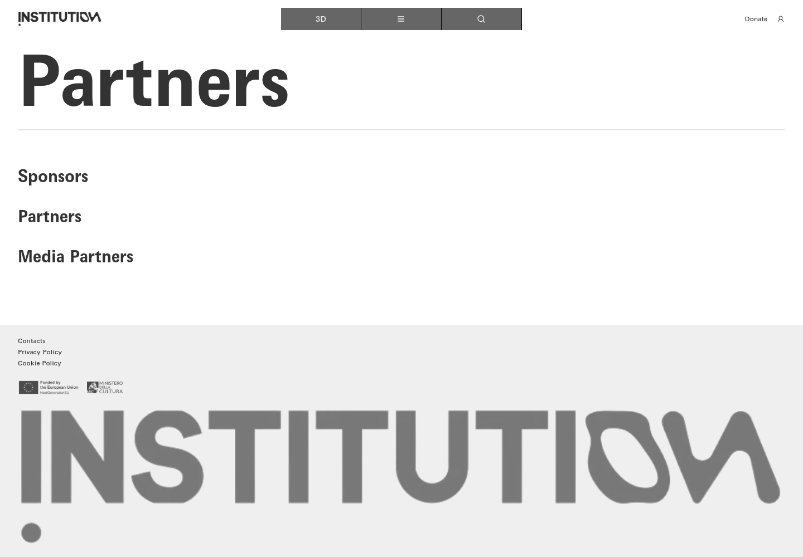
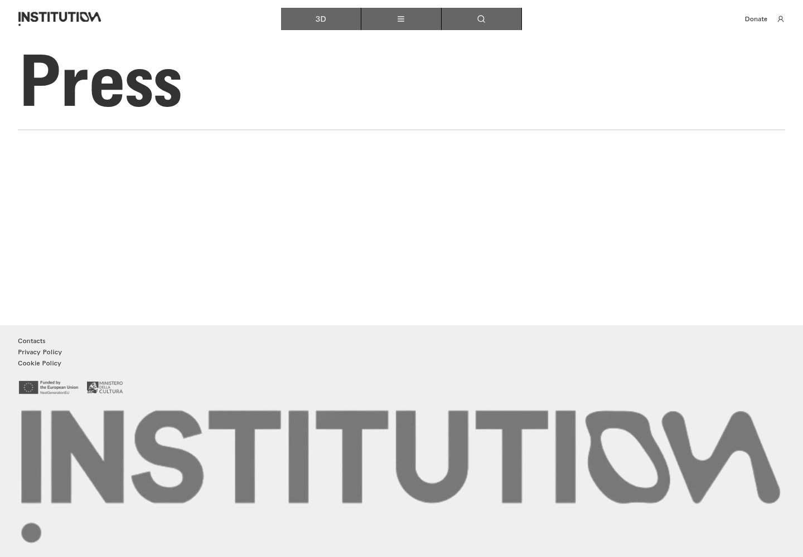

# 18｜其他栏目与机构信息

[返回总目录](../README.md) · [上一章：日历筛选与日期](17-calendar.md) · [下一章：邮件订阅与校验](19-newsletter.md)

**路线：** 各栏目从主菜单或 All 菜单独立进入，阅读后回到导航。空栏目保留截图。

> Figma 尚未取得，以下全部是网站实测。未编造设计画面；比较列保留“待匹配”。

## W091｜导航栏目：活动

- **用户操作：** 从导航菜单选择对应栏目，或按该链接地址打开。
- **操作后结果：** 页面当前只展示栏目标题和公共导航／页脚，没有内容卡片。
- **中文备注／不确定性：** 记录为空栏目；不把“空栏目”记作链接无效。
- **Figma：** 尚未取得设计画板，无法匹配。
- **来源：** 2026-10-16 网站实测，旧版证据编号 089。

[查看／下载原始截图](../screenshots/section-events.png)

## W092｜导航栏目：收藏集

- **用户操作：** 从导航菜单选择对应栏目，或按该链接地址打开。
- **操作后结果：** 页面当前只展示栏目标题和公共导航／页脚，没有内容卡片。
- **中文备注／不确定性：** 记录为空栏目；不把“空栏目”记作链接无效。
- **Figma：** 尚未取得设计画板，无法匹配。
- **来源：** 2026-10-16 网站实测，旧版证据编号 090。

[查看／下载原始截图](../screenshots/section-collections.png)

## W093｜导航栏目：参与

- **用户操作：** 从导航菜单选择对应栏目，或按该链接地址打开。
- **操作后结果：** 页面当前只展示栏目标题和公共导航／页脚，没有内容卡片。
- **中文备注／不确定性：** 记录为空栏目；不把“空栏目”记作链接无效。
- **Figma：** 尚未取得设计画板，无法匹配。
- **来源：** 2026-10-16 网站实测，旧版证据编号 092。

[查看／下载原始截图](../screenshots/section-participation.png)

## W094｜导航栏目：教育

- **用户操作：** 从导航菜单选择对应栏目，或按该链接地址打开。
- **操作后结果：** 页面当前只展示栏目标题和公共导航／页脚，没有内容卡片。
- **中文备注／不确定性：** 记录为空栏目；不把“空栏目”记作链接无效。
- **Figma：** 尚未取得设计画板，无法匹配。
- **来源：** 2026-10-16 网站实测，旧版证据编号 093。

[查看／下载原始截图](../screenshots/section-education.png)

## W095｜导航栏目：展览

- **用户操作：** 从导航菜单选择对应栏目，或按该链接地址打开。
- **操作后结果：** 页面当前只展示栏目标题和公共导航／页脚，没有内容卡片。
- **中文备注／不确定性：** 记录为空栏目；不把“空栏目”记作链接无效。
- **Figma：** 尚未取得设计画板，无法匹配。
- **来源：** 2026-10-16 网站实测，旧版证据编号 098。

[查看／下载原始截图](../screenshots/all-exhibitions.png)

## W096｜导航栏目：关于机构

- **用户操作：** 从导航菜单选择对应栏目，或按该链接地址打开。
- **操作后结果：** 进入关于机构页面并记录完整页面。
- **中文备注／不确定性：** 公共顶栏可进行平台切换、导航、搜索、捐赠和账户操作；页脚通常提供联系方式及政策链接。
- **Figma：** 尚未取得设计画板，无法匹配。
- **来源：** 2026-10-16 网站实测，旧版证据编号 099。

[查看／下载原始截图](../screenshots/all-about.png)

## W097｜导航栏目：参观信息

- **用户操作：** 从导航菜单选择对应栏目，或按该链接地址打开。
- **操作后结果：** 进入参观信息页面并记录完整页面。
- **中文备注／不确定性：** 公共顶栏可进行平台切换、导航、搜索、捐赠和账户操作；页脚通常提供联系方式及政策链接。
- **Figma：** 尚未取得设计画板，无法匹配。
- **来源：** 2026-10-16 网站实测，旧版证据编号 100。

[查看／下载原始截图](../screenshots/all-visit.png)

## W098｜导航栏目：合作伙伴

- **用户操作：** 从导航菜单选择对应栏目，或按该链接地址打开。
- **操作后结果：** 进入合作伙伴页面并记录完整页面。
- **中文备注／不确定性：** 公共顶栏可进行平台切换、导航、搜索、捐赠和账户操作；页脚通常提供联系方式及政策链接。
- **Figma：** 尚未取得设计画板，无法匹配。
- **来源：** 2026-10-16 网站实测，旧版证据编号 101。

[查看／下载原始截图](../screenshots/all-partners.png)

## W099｜导航栏目：媒体资料

- **用户操作：** 从导航菜单选择对应栏目，或按该链接地址打开。
- **操作后结果：** 页面当前只展示栏目标题和公共导航／页脚，没有内容卡片。
- **中文备注／不确定性：** 记录为空栏目；不把“空栏目”记作链接无效。
- **Figma：** 尚未取得设计画板，无法匹配。
- **来源：** 2026-10-16 网站实测，旧版证据编号 102。

[查看／下载原始截图](../screenshots/all-press.png)

## W100｜导航栏目：会员

- **用户操作：** 从导航菜单选择对应栏目，或按该链接地址打开。
- **操作后结果：** 进入会员页面并记录完整页面。
- **中文备注／不确定性：** 公共顶栏可进行平台切换、导航、搜索、捐赠和账户操作；页脚通常提供联系方式及政策链接。
- **Figma：** 尚未取得设计画板，无法匹配。
- **来源：** 2026-10-16 网站实测，旧版证据编号 103。

[查看／下载原始截图](../screenshots/all-memberships.png)

---

[返回总目录](../README.md) · [上一章：日历筛选与日期](17-calendar.md) · [下一章：邮件订阅与校验](19-newsletter.md)
