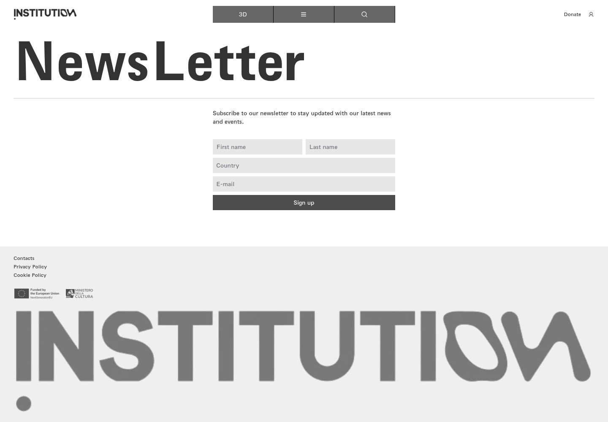
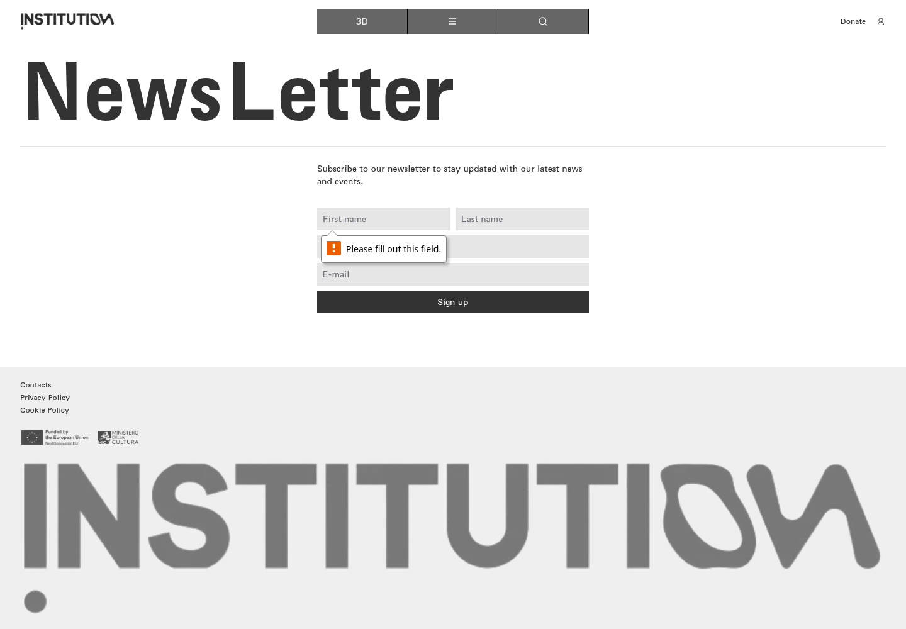
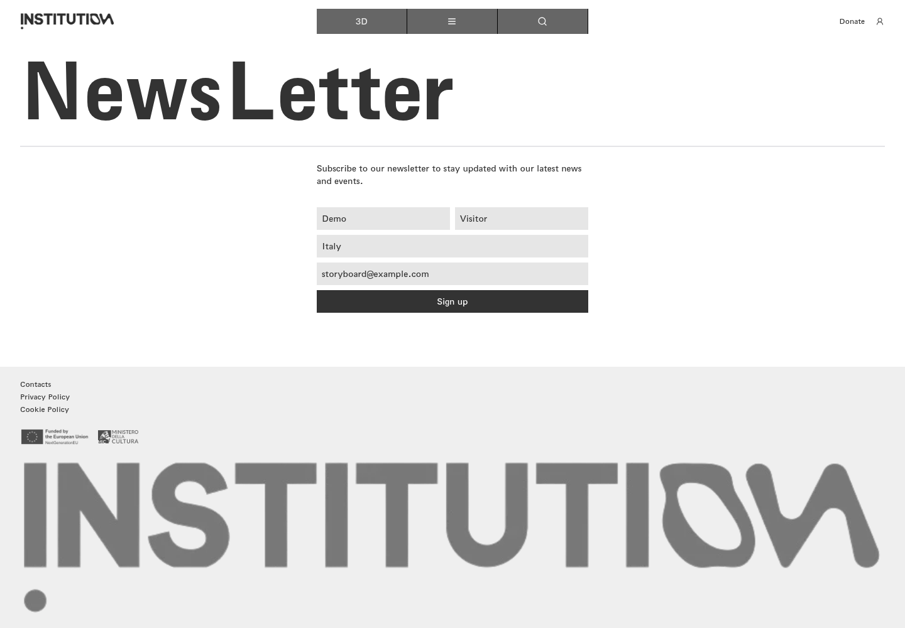

# 19｜邮件订阅与校验

[返回总目录](../README.md) · [上一章：其他栏目与机构信息](18-sections.md) · [下一章：商店、币种与购物车](20-store.md)

**路线：** 主菜单 → Newsletter → 空表单校验 → 示例填写。没有提交订阅。

> Figma 尚未取得，以下全部是网站实测。未编造设计画面；比较列保留“待匹配”。

## W101｜邮件订阅表单

- **用户操作：** 从导航选择 Newsletter（邮件订阅）。
- **操作后结果：** 显示姓名、姓氏、国家、邮箱及订阅按钮。
- **中文备注／不确定性：** 填写和必填验证见后续分镜；不提交真实订阅。
- **Figma：** 尚未取得设计画板，无法匹配。
- **来源：** 2026-10-16 网站实测，旧版证据编号 094。

[查看／下载原始截图](../screenshots/section-newsletter.png)

## W102｜订阅空表单验证

- **用户操作：** 不填写内容点击 Sign up（订阅）。
- **操作后结果：** 停留在订阅表单。
- **中文备注／不确定性：** 后续检查确认浏览器必填校验阻止提交；不属于无反应。
- **Figma：** 尚未取得设计画板，无法匹配。
- **来源：** 2026-10-16 网站实测，旧版证据编号 095。

[查看／下载原始截图](../screenshots/newsletter-empty-validation.png)

## W103｜确认订阅必填校验

- **用户操作：** 空表单点击订阅并检查校验状态。
- **操作后结果：** 姓名、姓氏、国家、邮箱均为必填且 invalid。
- **中文备注／不确定性：** 浏览器提示“请填写此字段”；截图可能不包含原生校验气泡，字段校验证据另存。
- **Figma：** 尚未取得设计画板，无法匹配。
- **来源：** 2026-10-16 网站实测，旧版证据编号 096。

[查看／下载原始截图](../screenshots/newsletter-invalid-detail.png)

## W104｜填写订阅示例

- **用户操作：** 填写示例姓名、国家及 storyboard@example.com。
- **操作后结果：** 表单呈现填写完成状态。
- **中文备注／不确定性：** 没有提交订阅，不会给示例地址发送邮件。
- **Figma：** 尚未取得设计画板，无法匹配。
- **来源：** 2026-10-16 网站实测，旧版证据编号 097。

[查看／下载原始截图](../screenshots/newsletter-filled.png)

---

[返回总目录](../README.md) · [上一章：其他栏目与机构信息](18-sections.md) · [下一章：商店、币种与购物车](20-store.md)
