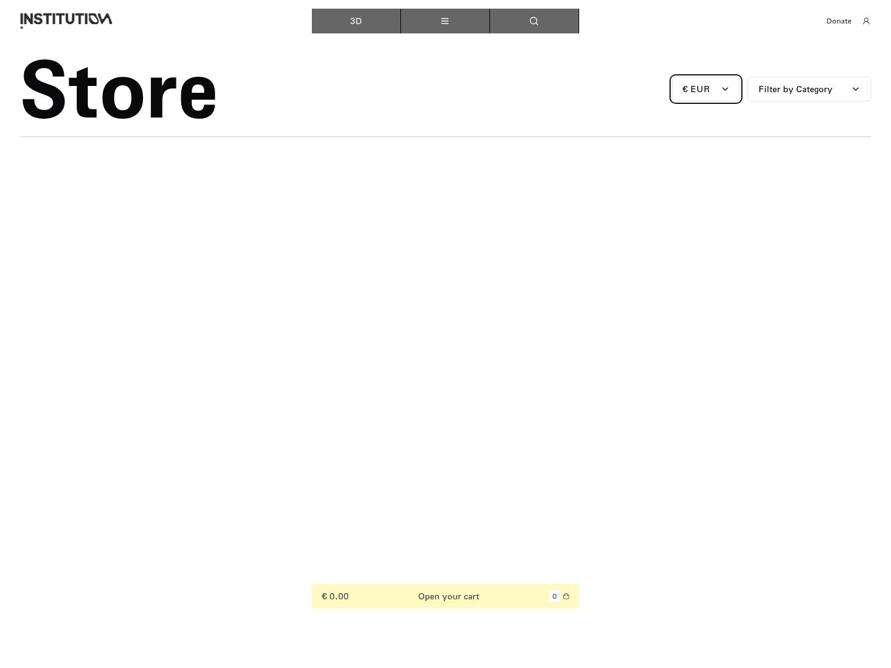
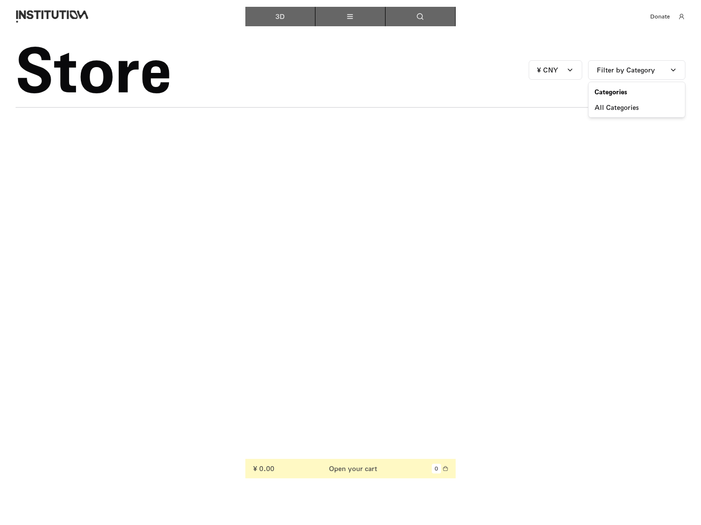
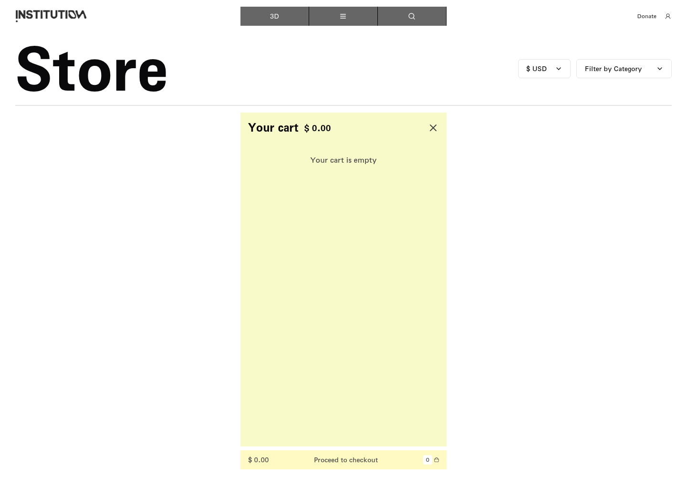

# 20｜商店、币种与购物车

[返回总目录](../README.md) · [上一章：邮件订阅与校验](19-newsletter.md) · [下一章：推荐内容表单](21-suggest.md)

**路线：** All 菜单 → Store → 切换币种／分类 → 打开空车 → 点击结账。未购买。

> Figma 尚未取得，以下全部是网站实测。未编造设计画面；比较列保留“待匹配”。

## W105｜导航栏目：商店

- **用户操作：** 从导航菜单选择对应栏目，或按该链接地址打开。
- **操作后结果：** 进入商店页面并记录完整页面。
- **中文备注／不确定性：** 公共顶栏可进行平台切换、导航、搜索、捐赠和账户操作；页脚通常提供联系方式及政策链接。
- **Figma：** 尚未取得设计画板，无法匹配。
- **来源：** 2026-10-16 网站实测，旧版证据编号 104。

[查看／下载原始截图](../screenshots/all-store.png)

## W106｜展开商店币种

- **用户操作：** 点击币种下拉。
- **操作后结果：** 显示美元、欧元和人民币三项。
- **中文备注／不确定性：** 币种切换只改变价格单位，不会购买商品。
- **Figma：** 尚未取得设计画板，无法匹配。
- **来源：** 2026-10-16 网站实测，旧版证据编号 105。

[查看／下载原始截图](../screenshots/store-currency.png)

## W107｜切换商店币种：USD

- **用户操作：** 在币种菜单点击相应选项。
- **操作后结果：** 顶栏币种和空购物车金额符号同步改变。
- **中文备注／不确定性：** 当前购物车金额仍为 0；选择当前币种时页面金额数值不变是正常状态。
- **Figma：** 尚未取得设计画板，无法匹配。
- **来源：** 2026-10-16 网站实测，旧版证据编号 106。

[查看／下载原始截图](../screenshots/store-currency-USD.png)

## W108｜切换商店币种：EUR

- **用户操作：** 在币种菜单点击相应选项。
- **操作后结果：** 顶栏币种和空购物车金额符号同步改变。
- **中文备注／不确定性：** 当前购物车金额仍为 0；选择当前币种时页面金额数值不变是正常状态。
- **Figma：** 尚未取得设计画板，无法匹配。
- **来源：** 2026-10-16 网站实测，旧版证据编号 107。

[查看／下载原始截图](../screenshots/store-currency-EUR.png)

## W109｜切换商店币种：CNY

- **用户操作：** 在币种菜单点击相应选项。
- **操作后结果：** 顶栏币种和空购物车金额符号同步改变。
- **中文备注／不确定性：** 当前购物车金额仍为 0；选择当前币种时页面金额数值不变是正常状态。
- **Figma：** 尚未取得设计画板，无法匹配。
- **来源：** 2026-10-16 网站实测，旧版证据编号 108。

[查看／下载原始截图](../screenshots/store-currency-CNY.png)

## W110｜展开商品分类

- **用户操作：** 点击 Filter by Category（按分类筛选）。
- **操作后结果：** 出现分类菜单，当前只有 All Categories（全部分类）。
- **中文备注／不确定性：** 分类菜单只显示“全部分类”。本次没有加购或付款；空车结账的实际点击结果另见后续分镜。
- **Figma：** 尚未取得设计画板，无法匹配。
- **来源：** 2026-10-16 网站实测，旧版证据编号 109。

[查看／下载原始截图](../screenshots/store-category.png)

## W111｜打开购物车

- **用户操作：** 点击底部 Open your cart（打开购物车）。
- **操作后结果：** 显示购物车面板及空购物车状态。
- **中文备注／不确定性：** 未进行交易；若没有商品，不能演示商品数量或结账后续。
- **Figma：** 尚未取得设计画板，无法匹配。
- **来源：** 2026-10-16 网站实测，旧版证据编号 110。

[查看／下载原始截图](../screenshots/store-cart.png)

## W112｜检查空购物车结账入口

- **用户操作：** 打开购物车查看底部 Proceed to checkout。
- **操作后结果：** 存在结账文字按钮；后续已实际点击复测。
- **中文备注／不确定性：** 该按钮没有 disabled 属性，不能称为禁用。真实点击结果见“空购物车点击结账”分镜。
- **Figma：** 尚未取得设计画板，无法匹配。
- **来源：** 2026-10-16 网站实测，旧版证据编号 111。

[查看／下载原始截图](../screenshots/store-checkout-disabled.png)

## W113｜空购物车点击结账

- **用户操作：** 点击底部带金额与数量的 Proceed to checkout。
- **操作后结果：** 购物车面板关闭，回到商店；未进入结账页面。
- **中文备注／不确定性：** 这次不是禁用，也不是完全无变化；表现为关闭购物车，未出现结账流程。
- **Figma：** 尚未取得设计画板，无法匹配。
- **来源：** 2026-10-16 网站实测，旧版证据编号 112。

[查看／下载原始截图](../screenshots/store-checkout-empty.png)

---

[返回总目录](../README.md) · [上一章：邮件订阅与校验](19-newsletter.md) · [下一章：推荐内容表单](21-suggest.md)
