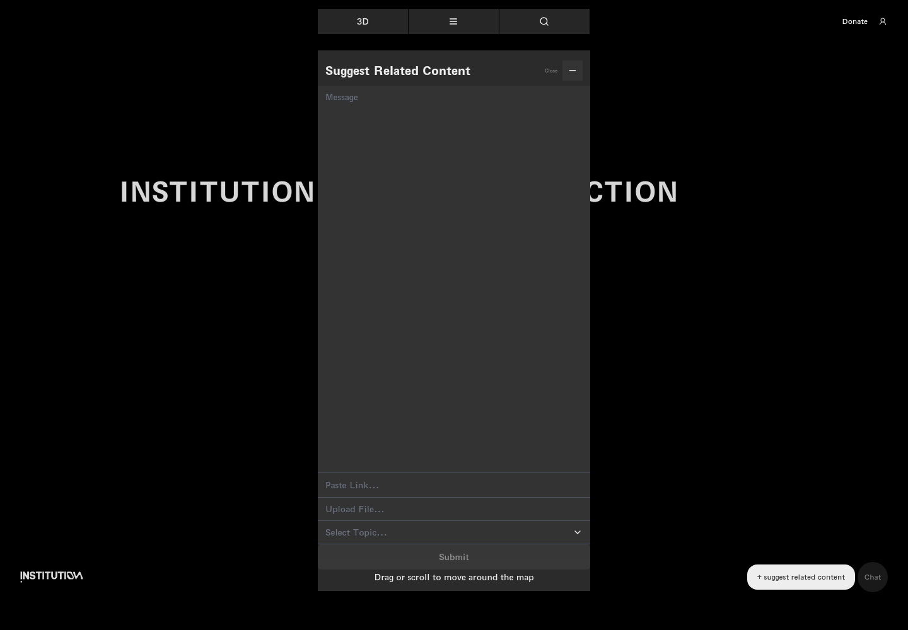
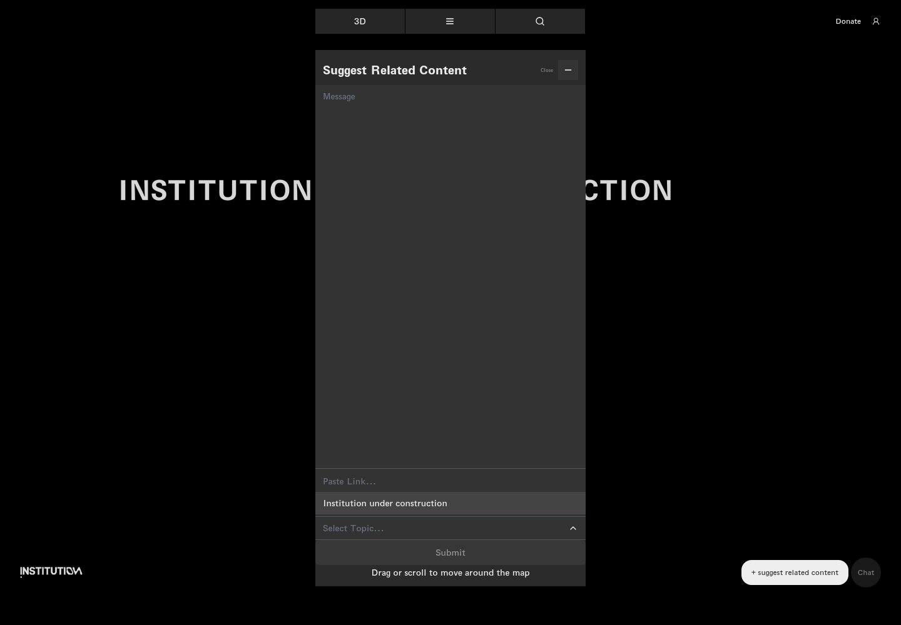
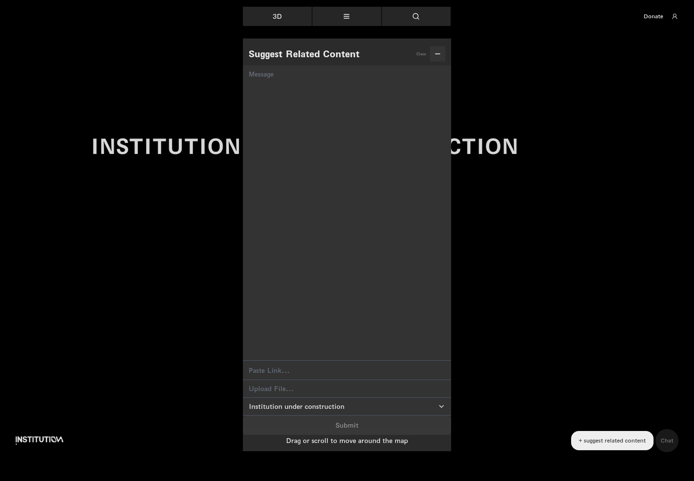
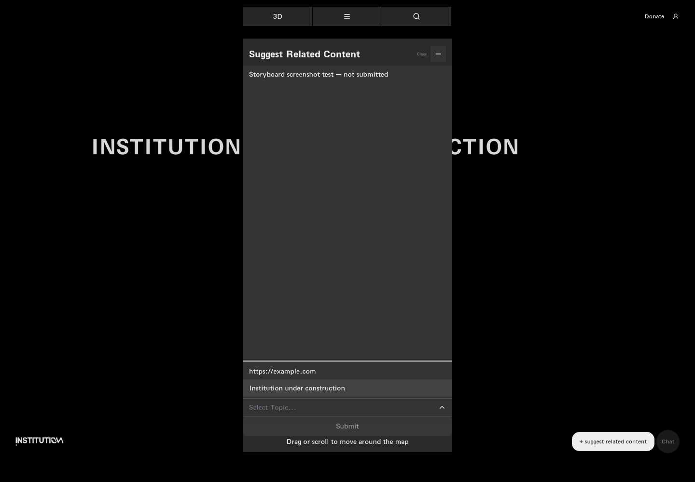
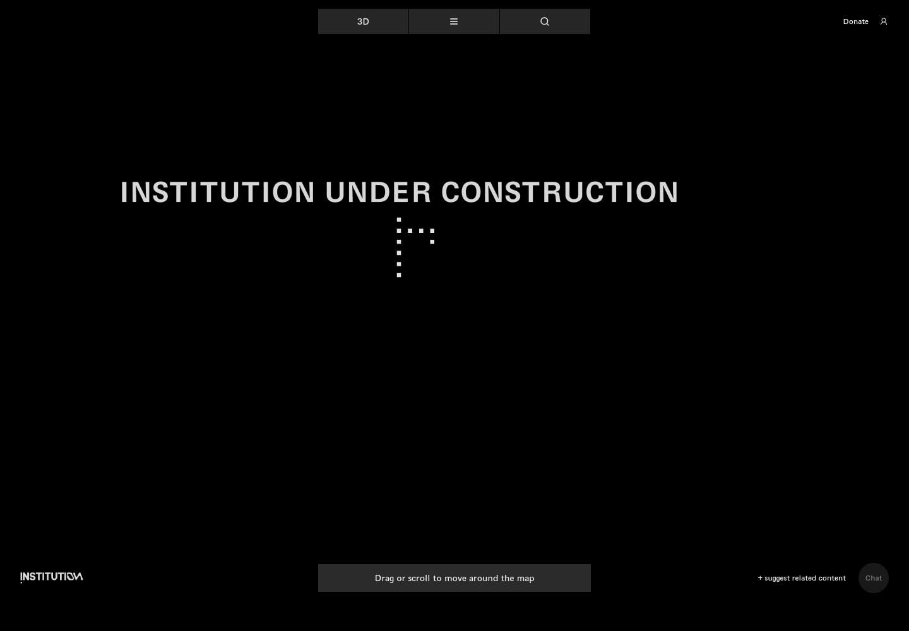

# 21｜推荐内容表单

[返回总目录](../README.md) · [上一章：商店、币种与购物车](20-store.md) · [下一章：捐赠金额、校验与政策](22-donate.md)

**路线：** 回到地图 → 推荐相关内容 → 主题、示例输入、文件选择 → 关闭。选择主题、输入示例与文件选择是分别检查的状态，不冒充一次完整提交。

> Figma 尚未取得，以下全部是网站实测。未编造设计画面；比较列保留“待匹配”。

## W114｜打开内容推荐表单

- **用户操作：** 点击右下方 + suggest related content（推荐相关内容）。
- **操作后结果：** 出现消息、链接、上传文件、主题及提交按钮。
- **中文备注／不确定性：** 空表单的 Submit 禁用；实际提交会创建内容，本次仅记录填写与选择状态。
- **Figma：** 尚未取得设计画板，无法匹配。
- **来源：** 2026-10-16 网站实测，旧版证据编号 113。

[查看／下载原始截图](../screenshots/19-suggest-content.png)

## W115｜展开推荐主题

- **用户操作：** 点击 Select Topic（选择主题）。
- **操作后结果：** 显示 Institution under construction 选项。
- **中文备注／不确定性：** 可选项来自当前站点，不推测未展示的主题。
- **Figma：** 尚未取得设计画板，无法匹配。
- **来源：** 2026-10-16 网站实测，旧版证据编号 114。

[查看／下载原始截图](../screenshots/suggest-topic.png)

## W116｜选定推荐主题

- **用户操作：** 点击 Institution under construction。
- **操作后结果：** 主题名称写入表单。
- **中文备注／不确定性：** 选中状态与未选择状态分开截图。
- **Figma：** 尚未取得设计画板，无法匹配。
- **来源：** 2026-10-16 网站实测，旧版证据编号 115。

[查看／下载原始截图](../screenshots/suggest-topic-selected.png)

## W117｜填写推荐示例

- **用户操作：** 填写示例消息与 example.com 链接。
- **操作后结果：** 输入内容可保留在表单中。
- **中文备注／不确定性：** 只填写未提交；示例不代表用户真实内容。
- **Figma：** 尚未取得设计画板，无法匹配。
- **来源：** 2026-10-16 网站实测，旧版证据编号 116。

[查看／下载原始截图](../screenshots/suggest-fill.png)

## W118｜打开文件选择器

- **用户操作：** 点击 Upload File（上传文件）。
- **操作后结果：** 浏览器触发文件选择器事件。
- **中文备注／不确定性：** 系统文件选择窗口不属于网页截图，当前图片记录网页本体；没有选择或上传任何文件。
- **Figma：** 尚未取得设计画板，无法匹配。
- **来源：** 2026-10-16 网站实测，旧版证据编号 117。

[查看／下载原始截图](../screenshots/suggest-file-picker.png)

## W119｜关闭推荐表单

- **用户操作：** 点击表单 Close（关闭）。
- **操作后结果：** 表单消失，回到地图视图。
- **中文备注／不确定性：** 没有提交推荐内容。
- **Figma：** 尚未取得设计画板，无法匹配。
- **来源：** 2026-10-16 网站实测，旧版证据编号 118。

[查看／下载原始截图](../screenshots/suggest-close.png)

---

[返回总目录](../README.md) · [上一章：商店、币种与购物车](20-store.md) · [下一章：捐赠金额、校验与政策](22-donate.md)
