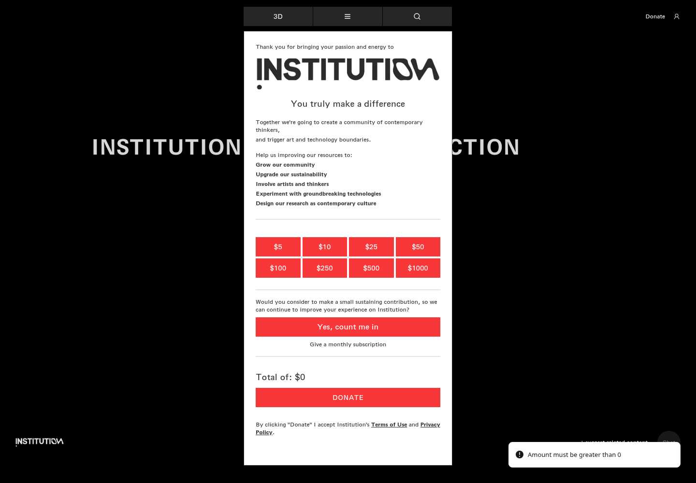
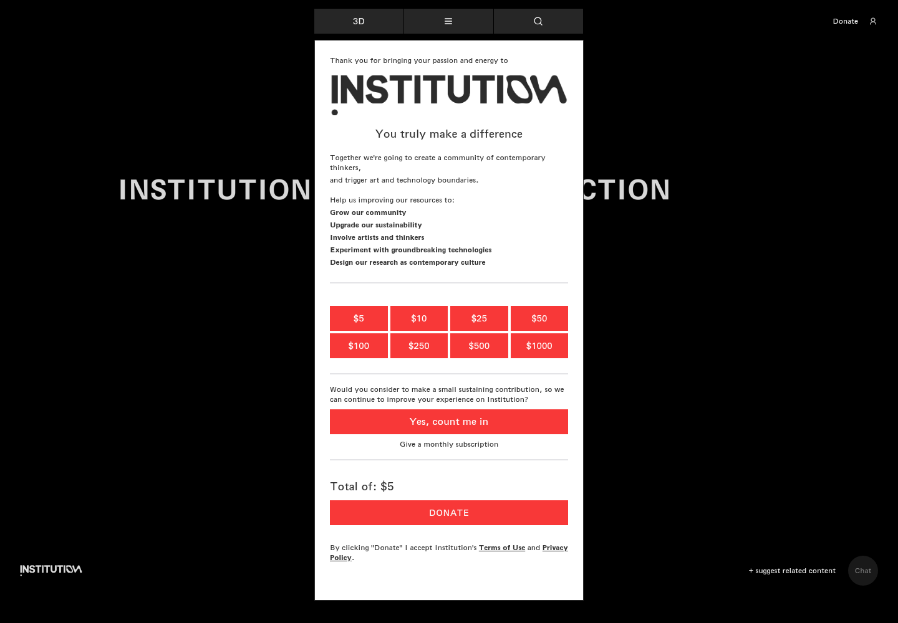
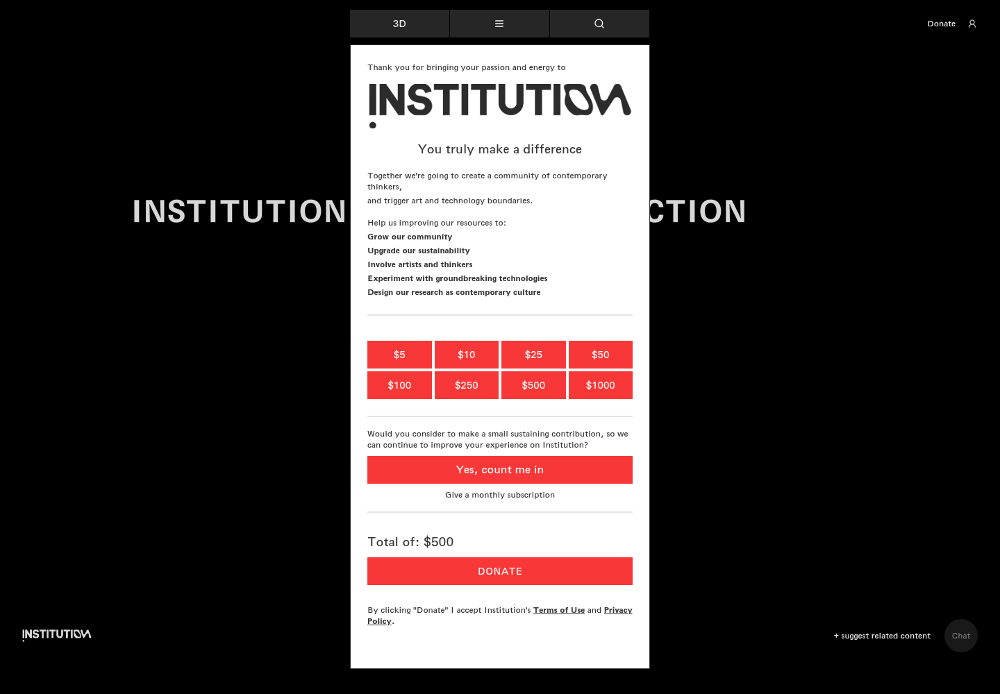
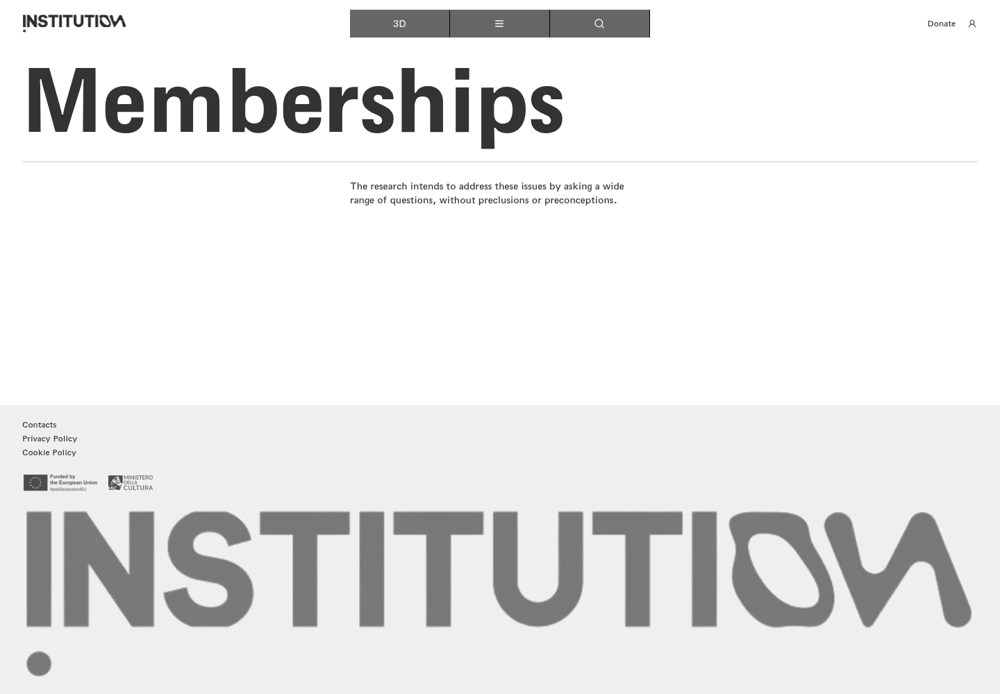

# 22｜捐赠金额、校验与政策

[返回总目录](../README.md) · [上一章：推荐内容表单](21-suggest.md) · [下一章：账户与讨论登录](23-login.md)

**路线：** 地图 Donate → 零金额校验或金额选择 → 政策链接／会员入口。这是多次重新打开面板的测试分支；没有支付。

> Figma 尚未取得，以下全部是网站实测。未编造设计画面；比较列保留“待匹配”。

## W120｜打开捐赠面板

- **用户操作：** 点击 Donate（捐赠支持）。
- **操作后结果：** 显示机构说明、8 个金额按钮、月度支持入口、总额及 DONATE。
- **中文备注／不确定性：** 初始总额为 $0；本次没有进行支付或捐赠。
- **Figma：** 尚未取得设计画板，无法匹配。
- **来源：** 2026-10-16 网站实测，旧版证据编号 119。

[查看／下载原始截图](../screenshots/20-donate.png)

## W121｜零金额捐赠校验

- **用户操作：** 总额为 0 时点击 DONATE。
- **操作后结果：** 页面显示 Amount must be greater than 0（金额必须大于零）。
- **中文备注／不确定性：** 这是明确的验证反馈，不属于无反应；未进行支付。
- **Figma：** 尚未取得设计画板，无法匹配。
- **来源：** 2026-10-16 网站实测，旧版证据编号 150。

[查看／下载原始截图](../screenshots/donate-zero.png)

## W122｜捐赠金额：5 美元

- **用户操作：** 点击 $5 金额按钮。
- **操作后结果：** 面板总额更新为 $5。
- **中文备注／不确定性：** 只选择金额，没有点击最终支付确认。
- **Figma：** 尚未取得设计画板，无法匹配。
- **来源：** 2026-10-16 网站实测，旧版证据编号 120。

[查看／下载原始截图](../screenshots/donate-5.png)

## W123｜捐赠金额：10 美元

- **用户操作：** 点击 $10 金额按钮。
- **操作后结果：** 面板总额更新为 $10。
- **中文备注／不确定性：** 只选择金额，没有点击最终支付确认。
- **Figma：** 尚未取得设计画板，无法匹配。
- **来源：** 2026-10-16 网站实测，旧版证据编号 121。

[查看／下载原始截图](../screenshots/donate-10.png)

## W124｜捐赠金额：25 美元

- **用户操作：** 点击 $25 金额按钮。
- **操作后结果：** 面板总额更新为 $25。
- **中文备注／不确定性：** 只选择金额，没有点击最终支付确认。
- **Figma：** 尚未取得设计画板，无法匹配。
- **来源：** 2026-10-16 网站实测，旧版证据编号 122。

[查看／下载原始截图](../screenshots/donate-25.png)

## W125｜捐赠金额：50 美元

- **用户操作：** 点击 $50 金额按钮。
- **操作后结果：** 面板总额更新为 $50。
- **中文备注／不确定性：** 只选择金额，没有点击最终支付确认。
- **Figma：** 尚未取得设计画板，无法匹配。
- **来源：** 2026-10-16 网站实测，旧版证据编号 123。

[查看／下载原始截图](../screenshots/donate-50.png)

## W126｜捐赠金额：100 美元

- **用户操作：** 点击 $100 金额按钮。
- **操作后结果：** 面板总额更新为 $100。
- **中文备注／不确定性：** 只选择金额，没有点击最终支付确认。
- **Figma：** 尚未取得设计画板，无法匹配。
- **来源：** 2026-10-16 网站实测，旧版证据编号 124。

[查看／下载原始截图](../screenshots/donate-100.png)

## W127｜捐赠金额：250 美元

- **用户操作：** 点击 $250 金额按钮。
- **操作后结果：** 面板总额更新为 $250。
- **中文备注／不确定性：** 只选择金额，没有点击最终支付确认。
- **Figma：** 尚未取得设计画板，无法匹配。
- **来源：** 2026-10-16 网站实测，旧版证据编号 125。

[查看／下载原始截图](../screenshots/donate-250.png)

## W128｜捐赠金额：500 美元

- **用户操作：** 点击 $500 金额按钮。
- **操作后结果：** 面板总额更新为 $500。
- **中文备注／不确定性：** 只选择金额，没有点击最终支付确认。
- **Figma：** 尚未取得设计画板，无法匹配。
- **来源：** 2026-10-16 网站实测，旧版证据编号 126。

[查看／下载原始截图](../screenshots/donate-500.png)

## W129｜捐赠金额：1000 美元

- **用户操作：** 点击 $1000 金额按钮。
- **操作后结果：** 面板总额更新为 $1000。
- **中文备注／不确定性：** 只选择金额，没有点击最终支付确认。
- **Figma：** 尚未取得设计画板，无法匹配。
- **来源：** 2026-10-16 网站实测，旧版证据编号 127。

[查看／下载原始截图](../screenshots/donate-1000.png)

## W130｜捐赠条款链接

- **用户操作：** 点击 Terms of Use（使用条款）。
- **操作后结果：** 未打开条款正文，面板仍显示捐赠说明。
- **中文备注／不确定性：** 链接目标为 #；记录为占位链接／没有有效内容跳转。
- **Figma：** 尚未取得设计画板，无法匹配。
- **来源：** 2026-10-16 网站实测，旧版证据编号 128。

[查看／下载原始截图](../screenshots/donate-terms.png)

## W131｜捐赠隐私链接

- **用户操作：** 点击捐赠面板 Privacy Policy（隐私政策）。
- **操作后结果：** 未打开隐私正文，捐赠面板保留。
- **中文备注／不确定性：** 该处目标为 #，与页脚有效的 /en/privacy-policy 不同。
- **Figma：** 尚未取得设计画板，无法匹配。
- **来源：** 2026-10-16 网站实测，旧版证据编号 129。

[查看／下载原始截图](../screenshots/donate-privacy.png)

## W132｜进入月度支持页面

- **用户操作：** 点击 Yes, count me in。
- **操作后结果：** 打开会员支持页面。
- **中文备注／不确定性：** 该入口为 /en/base/memberships，不代表已订阅或付款。
- **Figma：** 尚未取得设计画板，无法匹配。
- **来源：** 2026-10-16 网站实测，旧版证据编号 151。

[查看／下载原始截图](../screenshots/donate-monthly.png)

---

[返回总目录](../README.md) · [上一章：推荐内容表单](21-suggest.md) · [下一章：账户与讨论登录](23-login.md)
