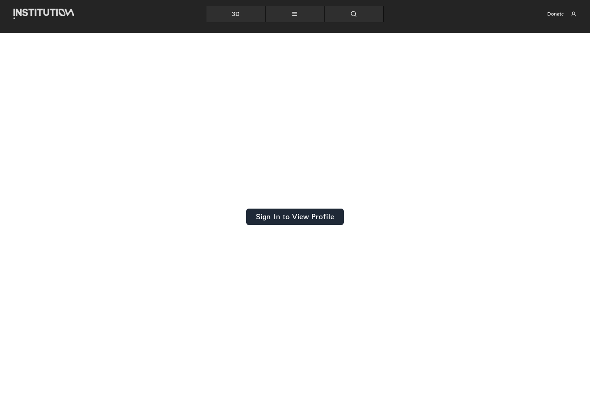
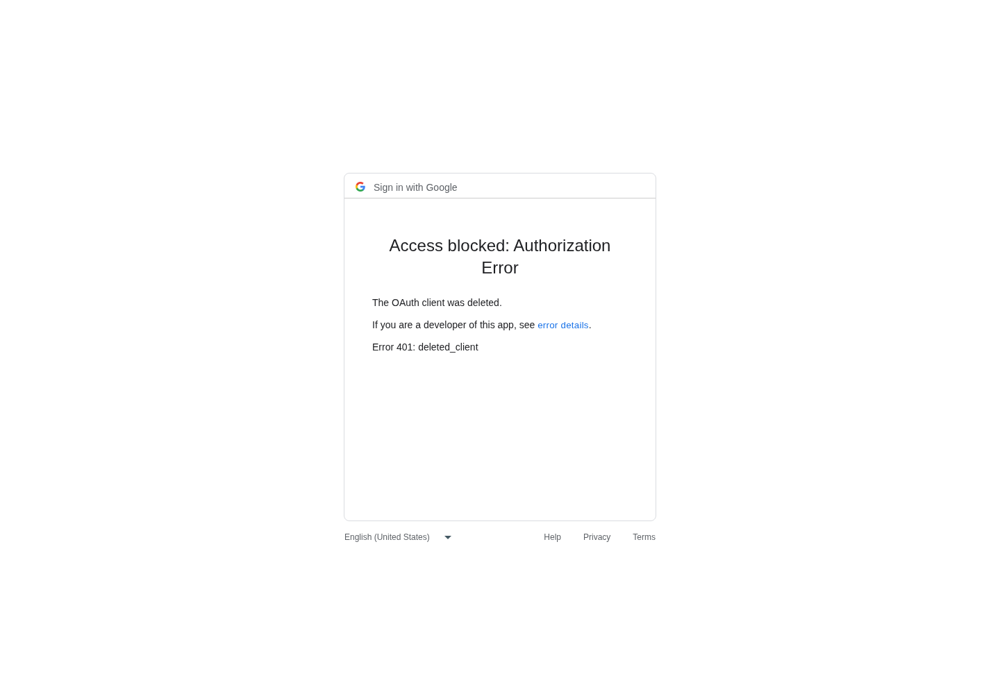
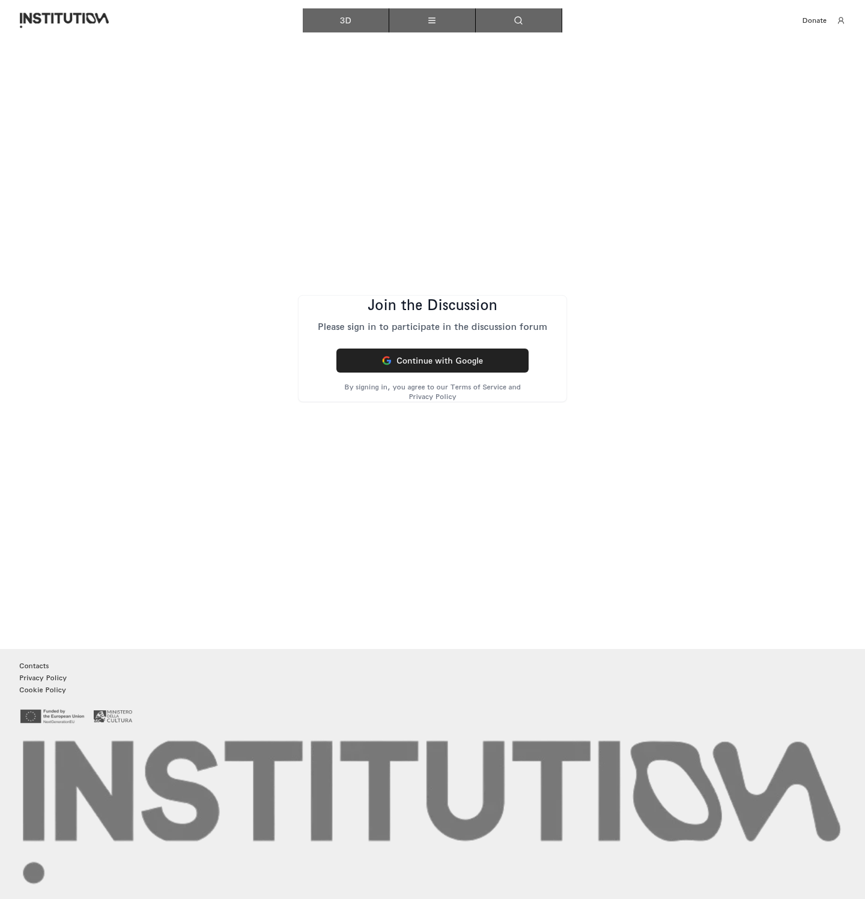

# 23｜账户与讨论登录

[返回总目录](../README.md) · [上一章：捐赠金额、校验与政策](22-donate.md) · [下一章：联系方式与 Email 入口](24-contact.md)

**路线：** 地图账户入口、Profile、Discussion 为三条独立登录路径；主站均返回 Google OAuth 错误。

> Figma 尚未取得，以下全部是网站实测。未编造设计画面；比较列保留“待匹配”。

## W133｜个人资料：未登录

- **用户操作：** 从导航选择 Profile（个人资料）。
- **操作后结果：** 页面显示 Sign In to View Profile（登录以查看个人资料）。
- **中文备注／不确定性：** Google OAuth 被阻断，因此未获得个人资料和账号内功能截图。
- **Figma：** 尚未取得设计画板，无法匹配。
- **来源：** 2026-10-16 网站实测，旧版证据编号 130。

[查看／下载原始截图](../screenshots/section-profile.png)

## W134｜打开账户登录面板

- **用户操作：** 点击右上角账户图标。
- **操作后结果：** 出现 Login、条款勾选框及 Google 登录按钮。
- **中文备注／不确定性：** 条款未勾选前 Google 按钮禁用。
- **Figma：** 尚未取得设计画板，无法匹配。
- **来源：** 2026-10-16 网站实测，旧版证据编号 131。

[查看／下载原始截图](../screenshots/21-profile-entry.png)

## W135｜启用 Google 登录入口

- **用户操作：** 勾选 Agree to our terms of use（同意使用条款）。
- **操作后结果：** Google 登录按钮变为可用。
- **中文备注／不确定性：** 这是本次流程选择状态，不代表已完成账号登录。
- **Figma：** 尚未取得设计画板，无法匹配。
- **来源：** 2026-10-16 网站实测，旧版证据编号 132。

[查看／下载原始截图](../screenshots/23-login-terms.png)

## W136｜Google 授权阻断

- **用户操作：** 点击 Continue with Google（使用 Google 继续）。
- **操作后结果：** Google 返回：The OAuth client was deleted；Error 401: deleted_client。
- **中文备注／不确定性：** 确认的网站 OAuth 配置错误。当前浏览器未获得用户会话，登录后的功能尚不能截图。
- **Figma：** 尚未取得设计画板，无法匹配。
- **来源：** 2026-10-16 网站实测，旧版证据编号 133。

[查看／下载原始截图](../screenshots/24-google-auth.png)

## W137｜个人资料登录按钮

- **用户操作：** 点击 Sign In to View Profile。
- **操作后结果：** 跳转到 Google 授权错误页，明确显示 Error 401: deleted_client。
- **中文备注／不确定性：** 与地图登录入口同样失败，确认主站 OAuth 客户端已被删除；没有取得账号会话。
- **Figma：** 尚未取得设计画板，无法匹配。
- **来源：** 2026-10-16 网站实测，旧版证据编号 148。

[查看／下载原始截图](../screenshots/profile-signin-button.png)

## W138｜讨论栏目：登录要求

- **用户操作：** 从导航选择 Discussion（讨论）。
- **操作后结果：** 提示登录后才能参加论坛，并显示 Google 登录入口。
- **中文备注／不确定性：** 未登录状态不能展开真实讨论、发表或账号互动。
- **Figma：** 尚未取得设计画板，无法匹配。
- **来源：** 2026-10-16 网站实测，旧版证据编号 091。

[查看／下载原始截图](../screenshots/section-discussion.png)

## W139｜讨论页登录按钮

- **用户操作：** 点击讨论页面 Continue with Google。
- **操作后结果：** 跳转到 Google 授权错误页，明确显示 Error 401: deleted_client。
- **中文备注／不确定性：** 与地图登录入口同样失败，确认主站 OAuth 客户端已被删除；没有取得账号会话。
- **Figma：** 尚未取得设计画板，无法匹配。
- **来源：** 2026-10-16 网站实测，旧版证据编号 149。

[查看／下载原始截图](../screenshots/discussion-google-button.png)

---

[返回总目录](../README.md) · [上一章：捐赠金额、校验与政策](22-donate.md) · [下一章：联系方式与 Email 入口](24-contact.md)
