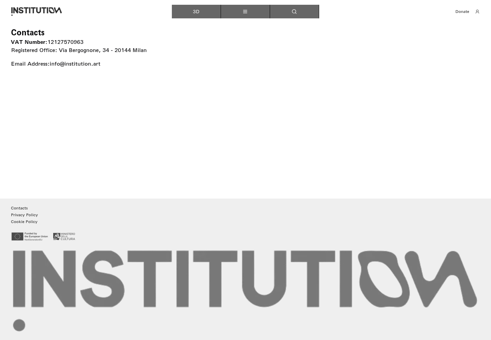
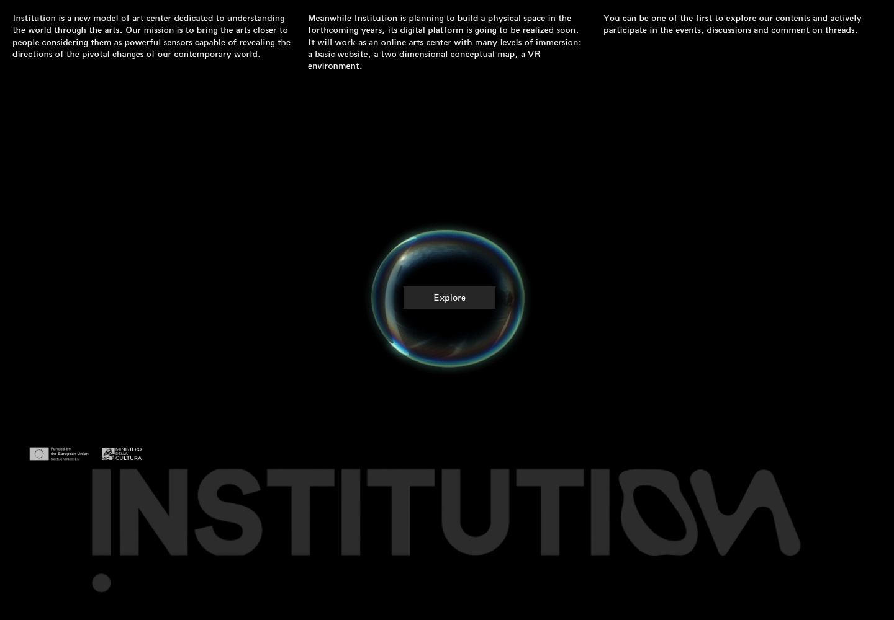

# 24｜联系方式与 Email 入口

[返回总目录](../README.md) · [上一章：账户与讨论登录](23-login.md) · [下一章：3D 加载与独立登录](25-vr.md)

**路线：** 页脚 Contacts；菜单 Email 分支。仅阅读，没有发送消息。

> Figma 尚未取得，以下全部是网站实测。未编造设计画面；比较列保留“待匹配”。

## W140｜打开联系信息

- **用户操作：** 点击页脚 Contacts（联系方式）。
- **操作后结果：** 显示税号、米兰注册地址与机构邮箱。
- **中文备注／不确定性：** 仅查看信息，没有发送邮件。
- **Figma：** 尚未取得设计画板，无法匹配。
- **来源：** 2026-10-16 网站实测，旧版证据编号 134。

[查看／下载原始截图](../screenshots/contact.png)

## W141｜邮件社交入口：实际返回页面

- **用户操作：** 访问导航 Email 链接的目标 /email。
- **操作后结果：** 返回机构介绍和 Explore 入口，未启动邮件撰写。
- **中文备注／不确定性：** 该链接实际为网站内部路径，不是 mailto；本次没有发送邮件。
- **Figma：** 尚未取得设计画板，无法匹配。
- **来源：** 2026-10-16 网站实测，旧版证据编号 135。

[查看／下载原始截图](../screenshots/social-email.png)

---

[返回总目录](../README.md) · [上一章：账户与讨论登录](23-login.md) · [下一章：3D 加载与独立登录](25-vr.md)
