# 25｜3D 加载与独立登录

[返回总目录](../README.md) · [上一章：联系方式与 Email 入口](24-contact.md)

**路线：** 首页选择 3D。初次进入截图与 15–180 秒加载序列来自不同访问；时间序列按等待标签排序，不能合并为一次连续计时。授权组件也曾单独打开验证。

> Figma 尚未取得，以下全部是网站实测。未编造设计画面；比较列保留“待匹配”。

## W142｜3D 初次进入：资源加载

- **用户操作：** 打开对应入口并记录。
- **操作后结果：** 白色背景中显示机构图形与加载进度条。
- **中文备注／不确定性：** 这是首次短等待截图；不是登录成功后的 3D 场景。后续时间序列是另一次加载检查。
- **Figma：** 尚未取得设计画板，无法匹配。
- **来源：** 2026-10-16 网站实测，旧版证据编号 147。

[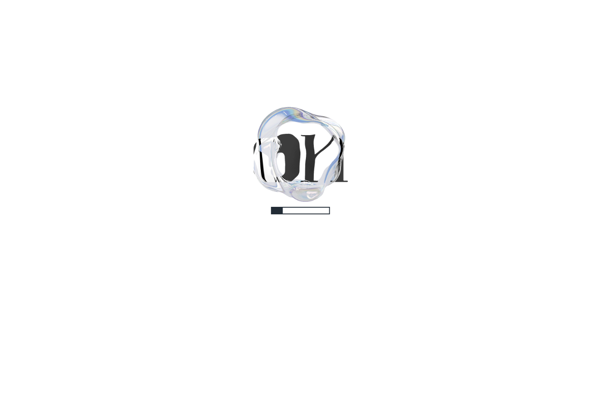](../screenshots/16-vr-entry.png)

[查看／下载原始截图](../screenshots/16-vr-entry.png)

## W143｜3D 等待 15 秒后的画面

- **用户操作：** 从首页 3D 链接打开 vr.institution.art，等待资源加载。
- **操作后结果：** 仍为机构图形与加载进度条。
- **中文备注／不确定性：** 只确认资源载入状态，不能断言体验失败。
- **Figma：** 尚未取得设计画板，无法匹配。
- **来源：** 2026-10-16 网站实测，旧版证据编号 144。

[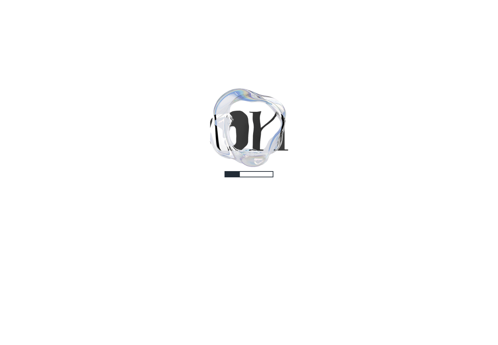](../screenshots/vr-15s.png)

[查看／下载原始截图](../screenshots/vr-15s.png)

## W144｜3D 等待 30 秒后的画面

- **用户操作：** 从首页 3D 链接打开 vr.institution.art，等待资源加载。
- **操作后结果：** 仍为机构图形与加载进度条。
- **中文备注／不确定性：** 只确认资源载入状态，不能断言体验失败。
- **Figma：** 尚未取得设计画板，无法匹配。
- **来源：** 2026-10-16 网站实测，旧版证据编号 145。

[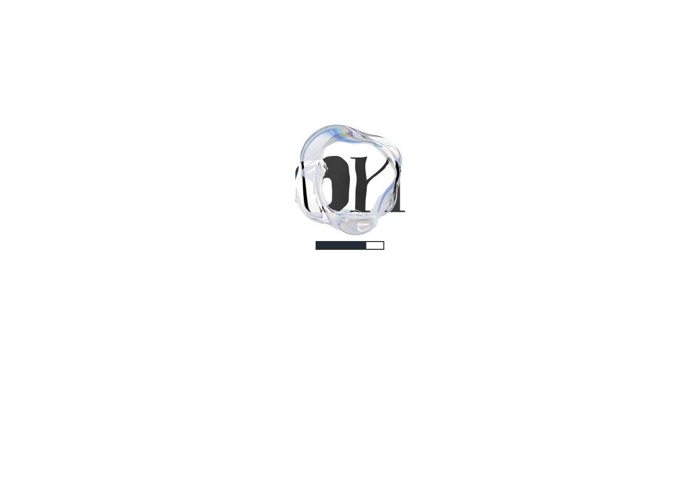](../screenshots/vr-30s.png)

[查看／下载原始截图](../screenshots/vr-30s.png)

## W145｜3D 等待 45 秒后的画面

- **用户操作：** 从首页 3D 链接打开 vr.institution.art，等待资源加载。
- **操作后结果：** 出现 Made with Unity 启动画面。
- **中文备注／不确定性：** 这是运行时启动阶段，不是展览内容。
- **Figma：** 尚未取得设计画板，无法匹配。
- **来源：** 2026-10-16 网站实测，旧版证据编号 141。

[查看／下载原始截图](../screenshots/vr-45s.png)

## W146｜3D 等待 60 秒后的画面

- **用户操作：** 从首页 3D 链接打开 vr.institution.art，等待资源加载。
- **操作后结果：** 黑色背景中央出现可读的 Sign in with Google 登录入口。
- **中文备注／不确定性：** 3D 使用独立授权组件；本次仍未登录。
- **Figma：** 尚未取得设计画板，无法匹配。
- **来源：** 2026-10-16 网站实测，旧版证据编号 142。

[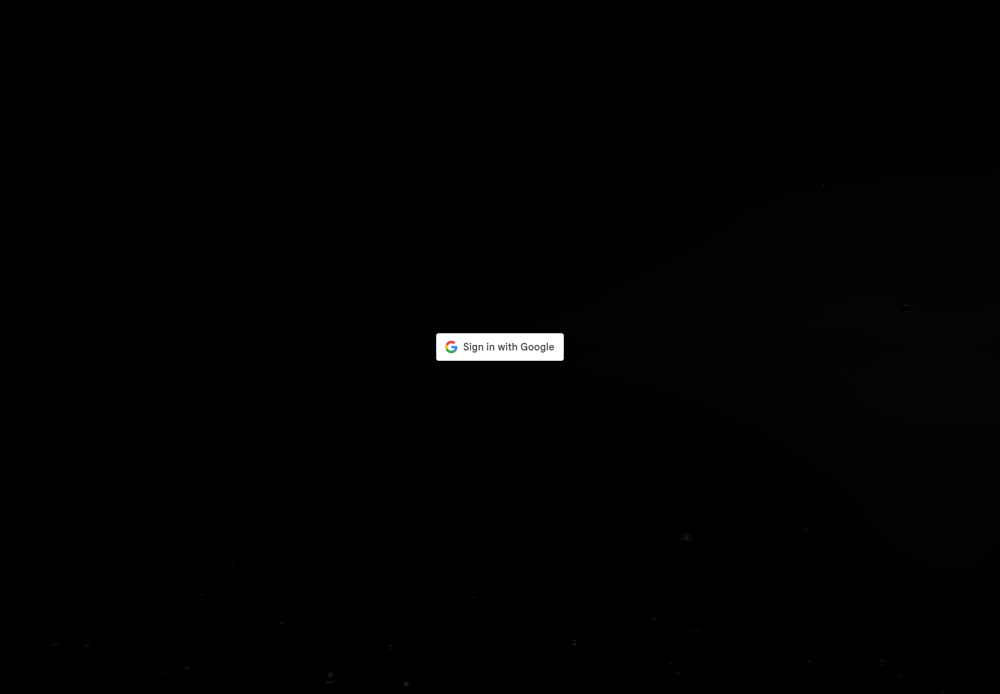](../screenshots/vr-60s.png)

[查看／下载原始截图](../screenshots/vr-60s.png)

## W147｜3D 等待 90 秒后的画面

- **用户操作：** 从首页 3D 链接打开 vr.institution.art，等待资源加载。
- **操作后结果：** 黑色背景中央出现白色按钮形矩形；本帧没有可读的 Google 登录文字。
- **中文备注／不确定性：** 可能与加载／绘制时机有关，原因未确认；保留本帧，不以其他帧代替。
- **Figma：** 尚未取得设计画板，无法匹配。
- **来源：** 2026-10-16 网站实测，旧版证据编号 140。

[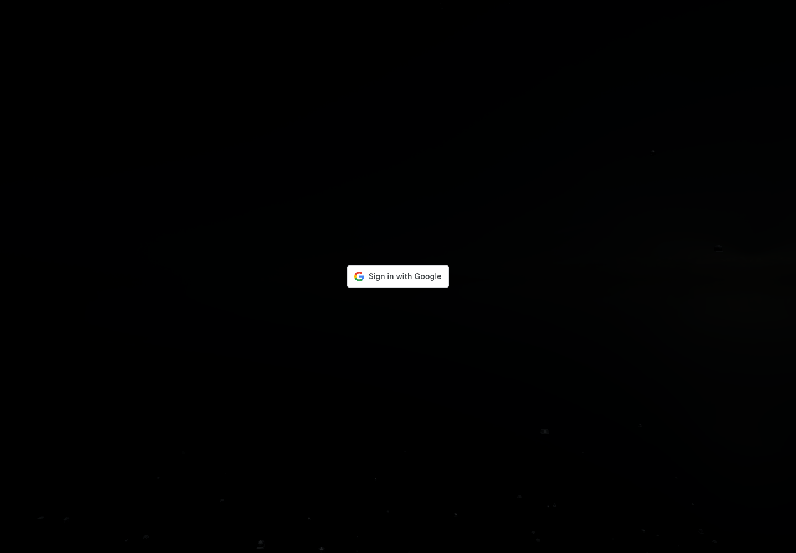](../screenshots/vr-90s.png)

[查看／下载原始截图](../screenshots/vr-90s.png)

## W148｜3D 等待 120 秒后的画面

- **用户操作：** 从首页 3D 链接打开 vr.institution.art，等待资源加载。
- **操作后结果：** 黑色背景中央出现可读的 Sign in with Google 登录入口。
- **中文备注／不确定性：** 3D 使用独立授权组件；本次仍未登录。
- **Figma：** 尚未取得设计画板，无法匹配。
- **来源：** 2026-10-16 网站实测，旧版证据编号 136。

[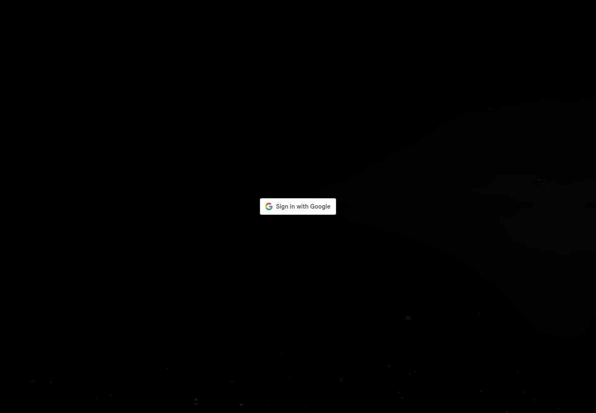](../screenshots/vr-120s.png)

[查看／下载原始截图](../screenshots/vr-120s.png)

## W149｜3D 等待 150 秒后的画面

- **用户操作：** 从首页 3D 链接打开 vr.institution.art，等待资源加载。
- **操作后结果：** 黑色背景中央出现白色按钮形矩形；本帧没有可读的 Google 登录文字。
- **中文备注／不确定性：** 可能与加载／绘制时机有关，原因未确认；保留本帧，不以其他帧代替。
- **Figma：** 尚未取得设计画板，无法匹配。
- **来源：** 2026-10-16 网站实测，旧版证据编号 146。

[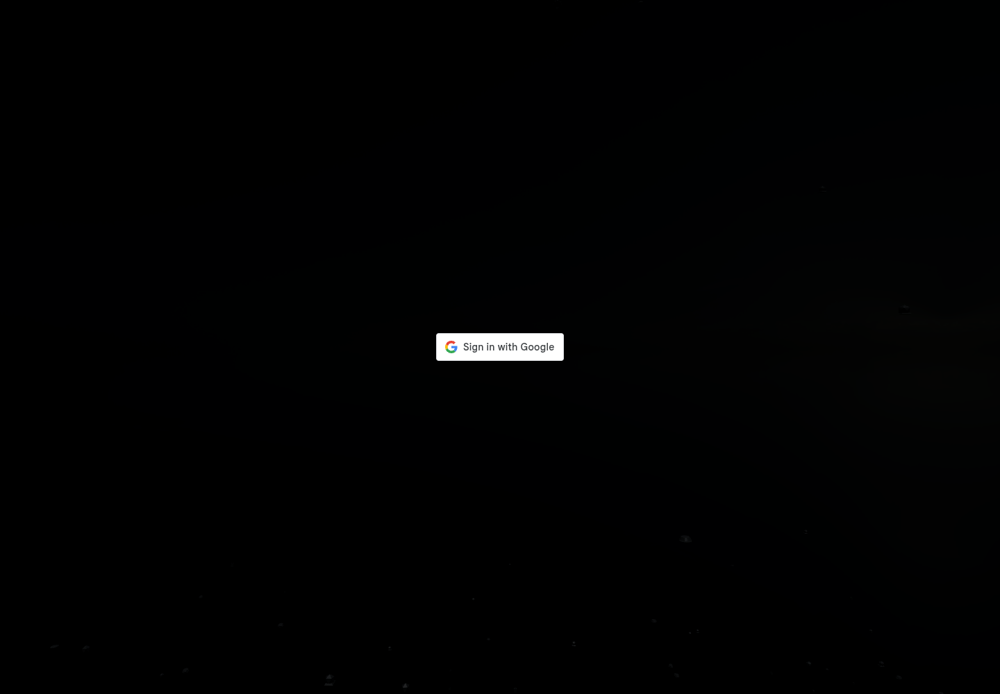](../screenshots/vr-150s.png)

[查看／下载原始截图](../screenshots/vr-150s.png)

## W150｜3D 等待 180 秒后的画面

- **用户操作：** 从首页 3D 链接打开 vr.institution.art，等待资源加载。
- **操作后结果：** 黑色背景中央出现白色按钮形矩形；本帧没有可读的 Google 登录文字。
- **中文备注／不确定性：** 可能与加载／绘制时机有关，原因未确认；保留本帧，不以其他帧代替。
- **Figma：** 尚未取得设计画板，无法匹配。
- **来源：** 2026-10-16 网站实测，旧版证据编号 137。

[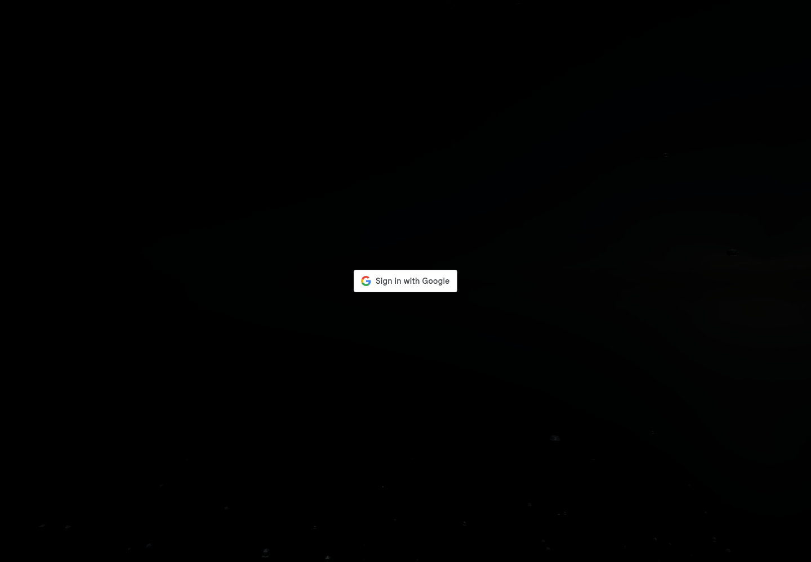](../screenshots/vr-180s.png)

[查看／下载原始截图](../screenshots/vr-180s.png)

## W151｜3D 独立授权组件

- **用户操作：** 打开 3D 平台所使用的 auth.institution.art 授权组件。
- **操作后结果：** 页面显示 Sign in with Google 登录入口。
- **中文备注／不确定性：** 此截图为独立授权组件直接访问状态，不冒充 3D 主场景。
- **Figma：** 尚未取得设计画板，无法匹配。
- **来源：** 2026-10-16 网站实测，旧版证据编号 139。

[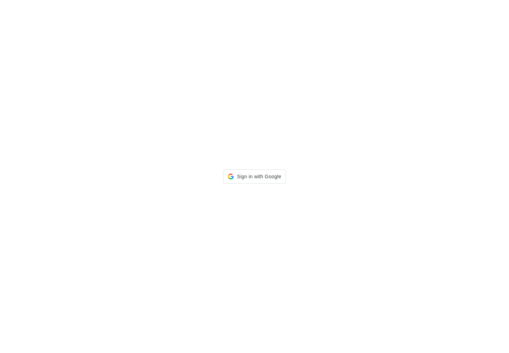](../screenshots/vr-auth-frame.png)

[查看／下载原始截图](../screenshots/vr-auth-frame.png)

## W152｜3D 的 Google 登录页

- **用户操作：** 在 3D 独立登录组件点击 Google 登录。
- **操作后结果：** Google 正常显示邮箱或手机号输入页，没有主站的 deleted_client 错误。
- **中文备注／不确定性：** 需要本人安全登录或共享已有会话才能继续；当前没有输入账号信息。
- **Figma：** 尚未取得设计画板，无法匹配。
- **来源：** 2026-10-16 网站实测，旧版证据编号 138。

[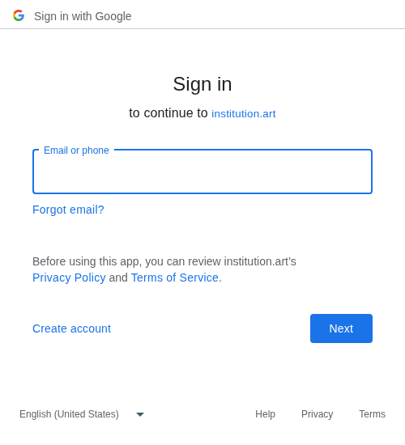](../screenshots/vr-google-popup.png)

[查看／下载原始截图](../screenshots/vr-google-popup.png)

## W153｜3D 授权弹窗打开后

- **用户操作：** 点击 Google 登录后保留授权组件页面。
- **操作后结果：** Google 弹窗另行打开；组件本身可能为空。
- **中文备注／不确定性：** 空白组件不等于登录无反应，登录输入在新窗口中。
- **Figma：** 尚未取得设计画板，无法匹配。
- **来源：** 2026-10-16 网站实测，旧版证据编号 143。

[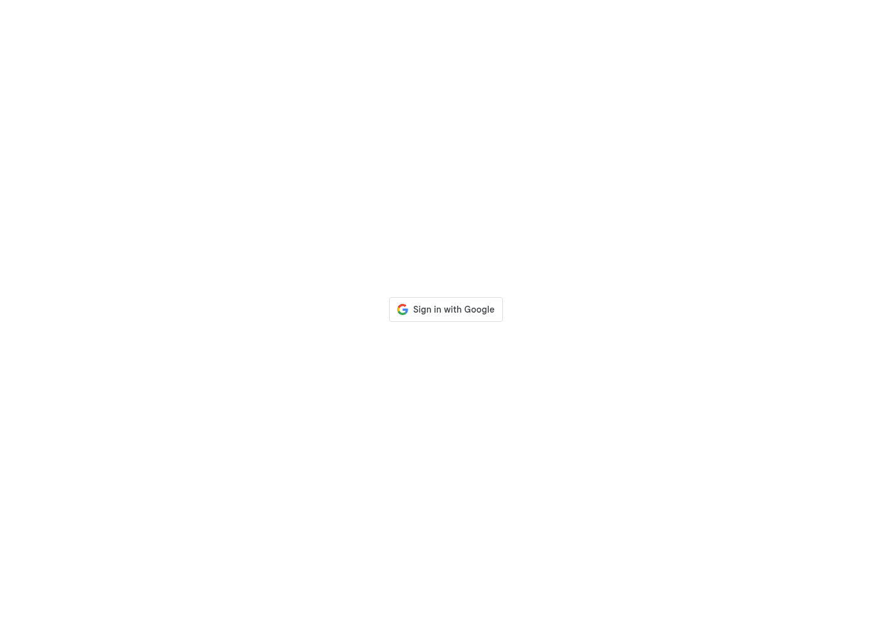](../screenshots/vr-google-after.png)

[查看／下载原始截图](../screenshots/vr-google-after.png)

---

[返回总目录](../README.md) · [上一章：联系方式与 Email 入口](24-contact.md)
