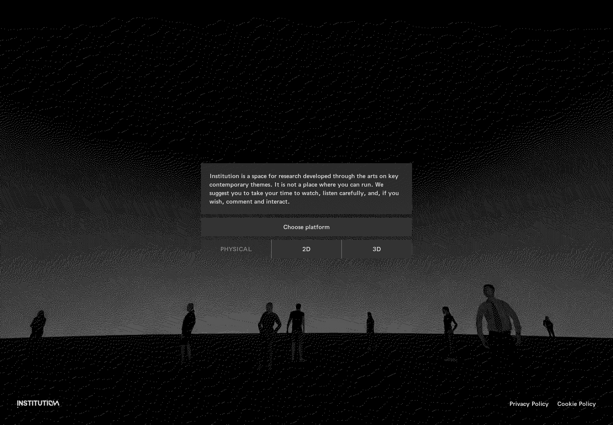
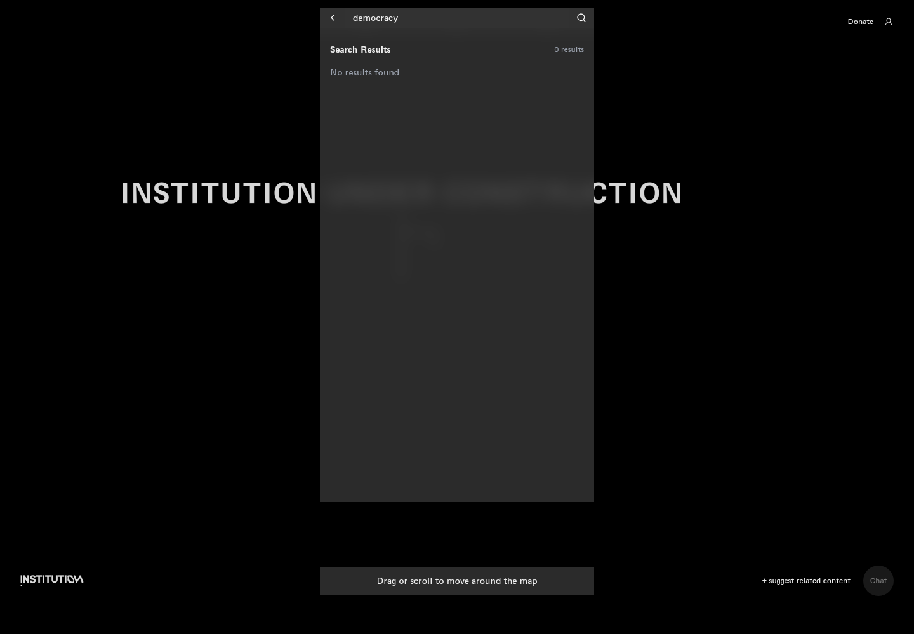
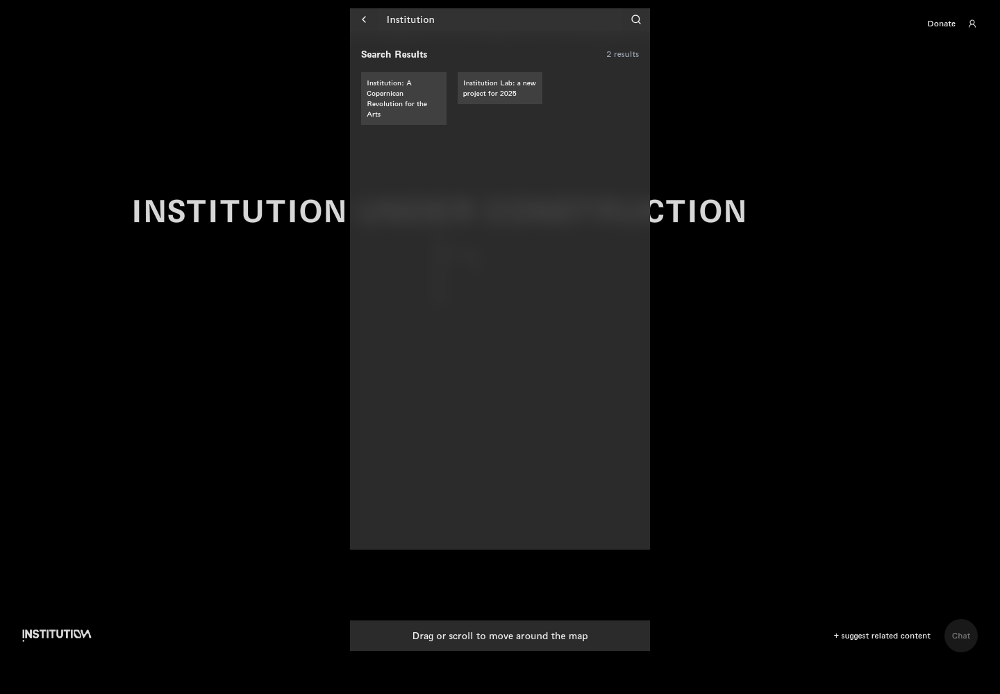
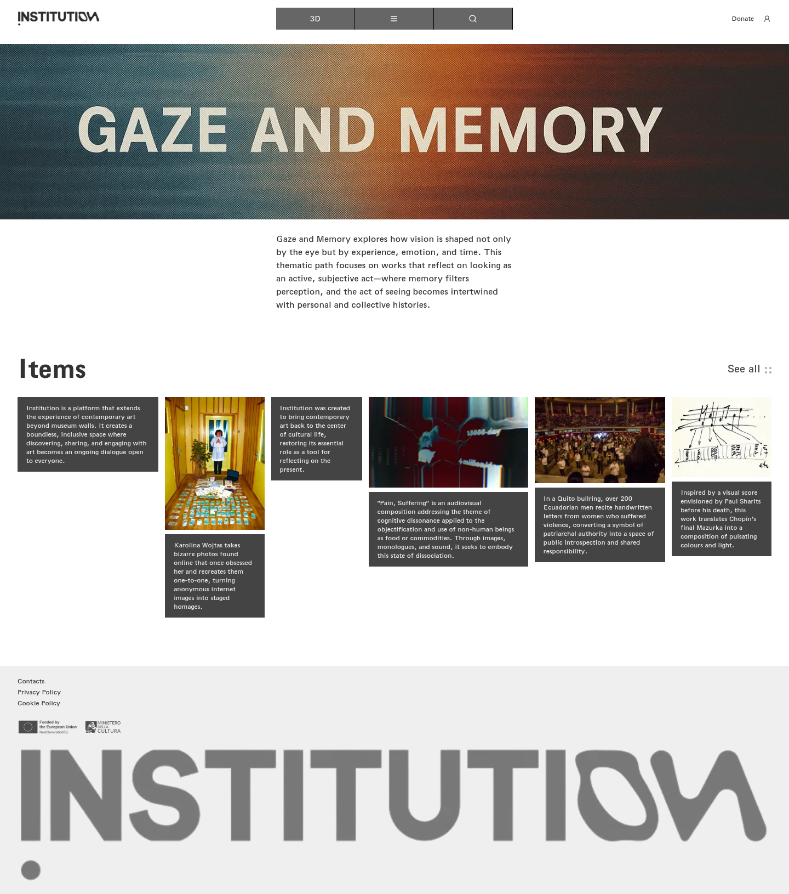
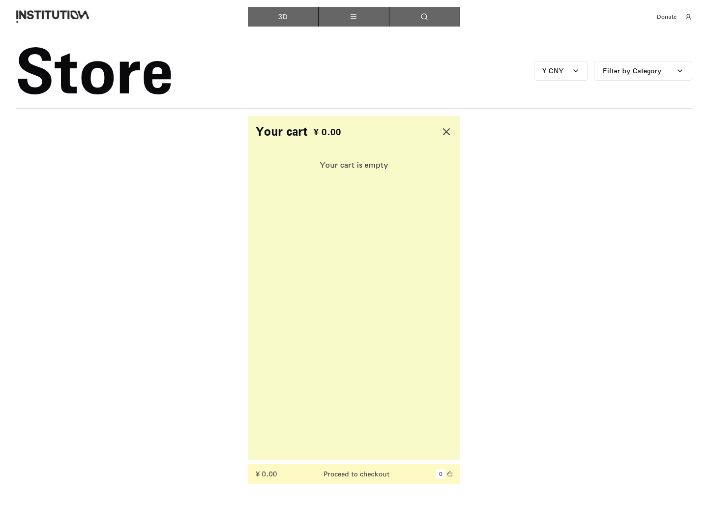
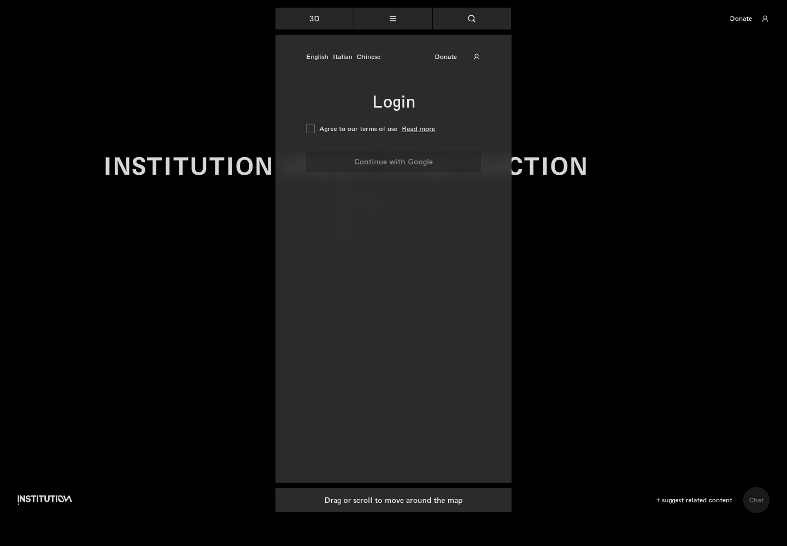
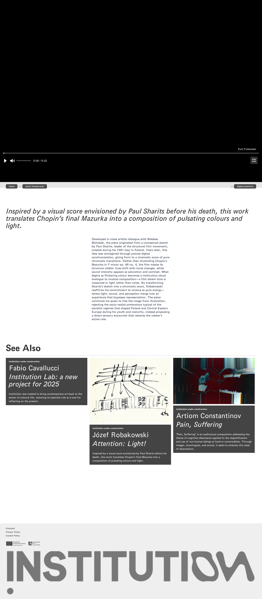
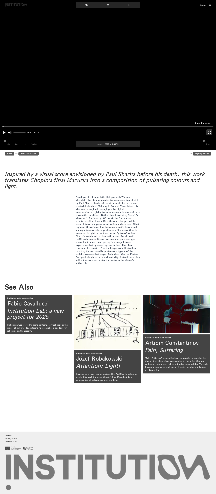

# 网站状态对比与设计匹配规则

[返回总目录](README.md)

这里的左右图均为真实网站截图。**目前没有可用的 Figma 画板，不能把此页说成已完成网站与设计稿对照。**

[Figma 访问说明与候选保留规则](figma/README.md)

## Cookie 提示前后

拒绝后提示消失；接受分支另存，不与拒绝串成一次会话。

| 状态 A | 状态 B |
|---|---|
| W001：首次打开首页 | W003：拒绝 Cookie 后的首页 |
|  |  |

## 地图说明展开与关闭

关闭后露出地图背景。

| 状态 A | 状态 B |
|---|---|
| W008：进入 2D：首次说明面板 | W009：关闭地图介绍 |
|  |  |

## 数字导航与完整导航

All 展示额外栏目；这是菜单分支。

| 状态 A | 状态 B |
|---|---|
| W011：展开主菜单：数字平台 | W012：切换完整导航 |
|  |  |

## 搜索空结果与有结果

不同关键词的结果对比，不是同一次搜索的前后。

| 状态 A | 状态 B |
|---|---|
| W016：搜索无结果分支 | W018：查看搜索结果 |
|  |  |

## 数字路径“查看全部”前后

不同捕获时刻；复测确认 URL 和正文均无变化。

| 状态 A | 状态 B |
|---|---|
| W025：凝视与记忆 | W026：凝视与记忆：查看全部无变化 |
|  |  |

## 购物车打开与点击结账后

不同币种测试分支；重点看空购物车点击后的面板关闭，不把币种差异误判为结账结果。

| 状态 A | 状态 B |
|---|---|
| W111：打开购物车 | W113：空购物车点击结账 |
|  |  |

## 条款未勾选与勾选

勾选后 Google 按钮可用，随后主站 OAuth 失败。

| 状态 A | 状态 B |
|---|---|
| W134：打开账户登录面板 | W135：启用 Google 登录入口 |
|  |  |

## 视频全屏与退出

通过 fullscreenElement 确认状态 true → false。

| 状态 A | 状态 B |
|---|---|
| W073：进入视频全屏 | W074：退出视频全屏 |
|  |  |

## 不确定画面保留规则

同一操作有多个设计候选时，分别展示候选 A、B、C，保留画板名、节点、版本、匹配依据与未确认点；不因外观相似直接定为同一页面。当前未取得设计，候选数量也无法确认。
